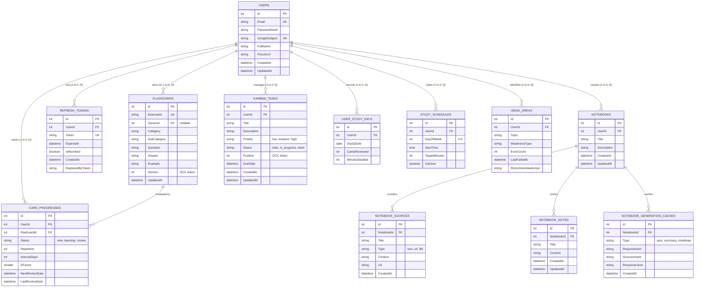
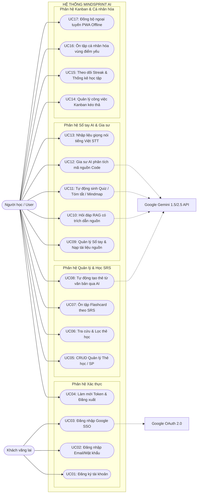
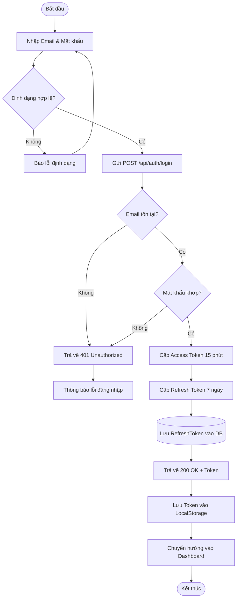
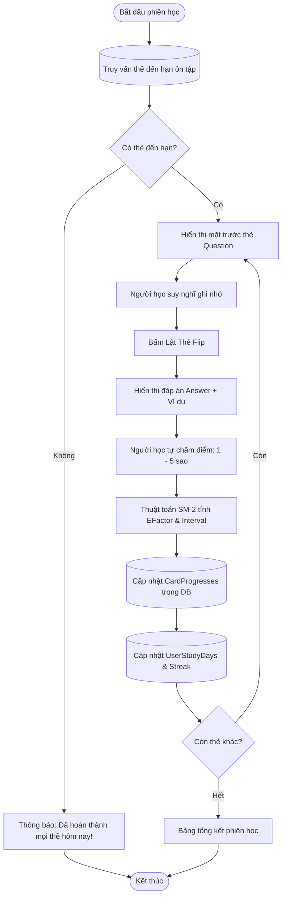
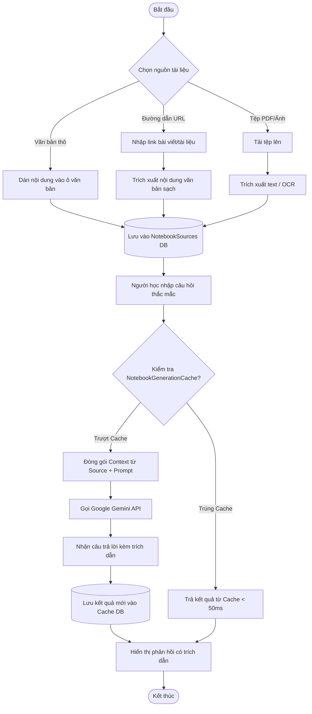
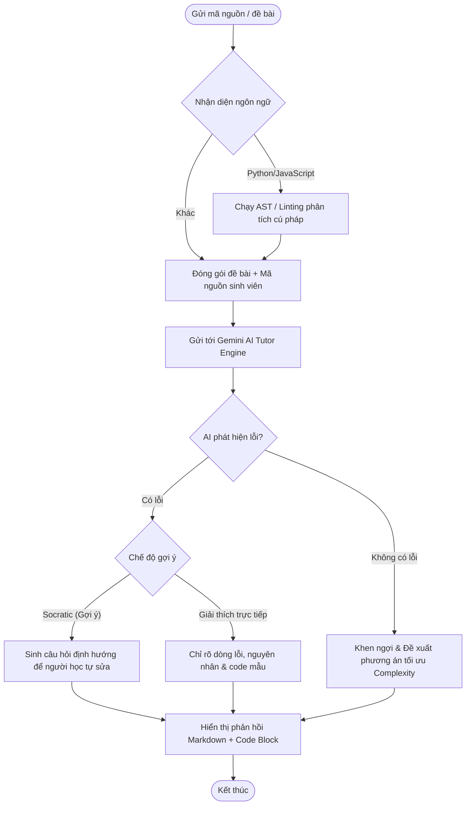
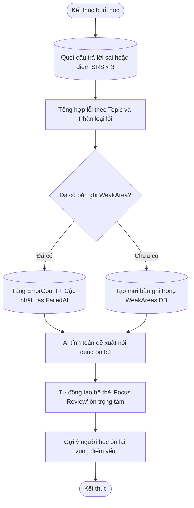
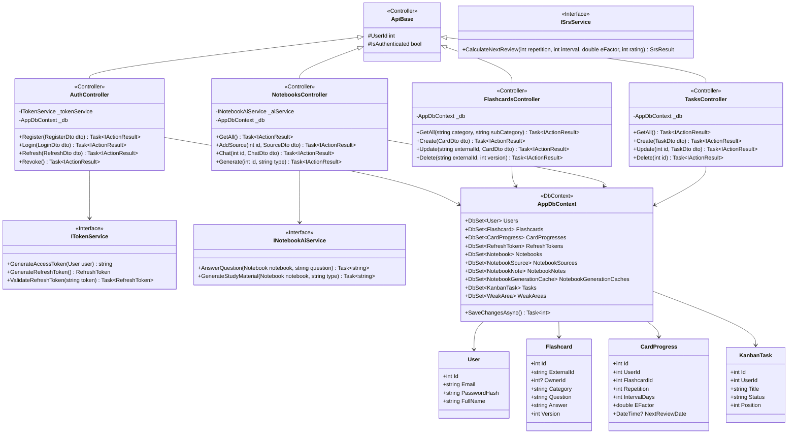

# BÁO CÁO TOÀN DIỆN ĐỒ ÁN MÔN HỌC & CÔNG NGHỆ PHẦN MỀM
# ĐỀ TÀI: HỆ THỐNG QUẢN LÝ VÀ HỖ TRỢ HỌC TẬP THÔNG MINH — MINDSPRINT AI

---

* **Đơn vị đào tạo:** Khoa Công nghệ Thông tin
* **Tên đề tài:** MindSprint AI — Nền tảng học tập thông minh tích hợp Flashcards SRS, Sổ tay AI RAG, Gia sư lập trình và Kanban
* **Kho lưu trữ GitHub:** [https://github.com/tungtungsahul/MindSprint-AI-D-n](https://github.com/tungtungsahul/MindSprint-AI-D-n)
* **Bản triển khai trực tiếp (Live Production):**
  * **Frontend (Vercel):** [https://mindsprint-ai-d-n-frontend.vercel.app/](https://mindsprint-ai-d-n-frontend.vercel.app/)
  * **Backend API (Render Cloud):** [https://mindsprint-api-zyur.onrender.com](https://mindsprint-api-zyur.onrender.com)
* **Danh sách nhóm sinh viên thực hiện (5 thành viên):**
  1. **Nguyễn Trần Bảo Duy** (MSSV / GitHub: `tungtungsahul` / `baoduy4bbt360`) — **Trưởng nhóm / Backend Lead**
  2. **Đỗ Đình Phan Diễn** (MSSV / GitHub: `phandien665-prog`) — **Frontend & Security Specialist**
  3. **Vũ Đình Hùng** (MSSV / GitHub: `James-Lloyd20` / `vudinhhung2906`) — **UI/UX & Voice AI Specialist**
  4. **Minh Chiến** (MSSV / GitHub: `mchihihaha` / `BAI250011`) — **AI Notebook & Load Test Specialist**
  5. **Tuấn Linh** (MSSV / GitHub: `tuanlinh0511` / `BAI252516`) — **Database Architect & UML Specialist**

---

# MỤC LỤC TỔNG THỂ

* [PHẦN I: BÁO CÁO DỰ ÁN TỔNG HỢP](#phần-i-báo-cáo-dự-án-tổng-hợp)
  * [1. Phát biểu bài toán](#1-phát-biểu-bài-toán)
    * [1.1. Bối cảnh và Tính cấp thiết](#11-bối-cảnh-và-tính-cấp-thiết)
    * [1.2. Mục tiêu đề tài](#12-mục-tiêu-đề-tài)
    * [1.3. Đối tượng và Phạm vi áp dụng](#13-đối-tượng-và-phạm-vi-áp-dụng)
    * [1.4. Đề xuất giải pháp công nghệ](#14-đề-xuất-giải-pháp-công-nghệ)
  * [2. Phân tích & Thiết kế](#2-phân-tích--thiết-kế)
    * [2.1. Thiết kế Cơ sở dữ liệu (CSDL)](#21-thiết-kế-cơ-sở-dữ-liệu-csdl)
      * [2.1.1. Xác định thực thể](#211-xác-định-thực-thể)
      * [2.1.2. Xác định mối quan hệ](#212-xác-định-mối-quan-hệ)
      * [2.1.3. Chuẩn hóa 3NF (Third Normal Form)](#213-chuẩn-hóa-3nf-third-normal-form)
      * [2.1.4. Lược đồ thực thể - mối quan hệ (ERD)](#214-lược-đồ-thực-thể---mối-quan-hệ-erd)
      * [2.1.5. Lược đồ cơ sở dữ liệu quan hệ (Database Diagram)](#215-lược-đồ-cơ-sở-dữ-liệu-quan-hệ-database-diagram)
      * [2.1.6. Chi tiết các bảng dữ liệu (Table Schemas / Data Dictionary)](#216-chi-tiết-các-bảng-dữ-liệu-table-schemas--data-dictionary)
    * [2.2. Thiết kế hệ thống](#22-thiết-kế-hệ-thống)
      * [2.2.1. Sơ đồ Use Case tổng quát và phân rã](#221-sơ-đồ-use-case-tổng-quát-và-phân-rã)
      * [2.2.2. Bảng đặc tả Use Case chi tiết](#222-bảng-đặc-tả-use-case-chi-tiết)
      * [2.2.3. Sơ đồ hoạt động (7 Activity Diagrams + Mô tả chi tiết)](#223-sơ-đồ-hoạt-động-7-activity-diagrams--mô-tả-chi-tiết)
      * [2.2.4. Sơ đồ lớp (Class Diagram theo mô hình MVC)](#224-sơ-đồ-lớp-class-diagram-theo-mô-hình-mvc)
      * [2.2.5. Sơ đồ triển khai hệ thống (Deployment Diagram)](#225-sơ-đồ-triển-khai-hệ-thống-deployment-diagram)
  * [3. Triển khai](#3-triển-khai)
    * [3.1. Triển khai Frontend (FE)](#31-triển-khai-frontend-fe)
    * [3.2. Triển khai Backend (BE)](#32-triển-khai-backend-be)
    * [3.3. Kiểm thử phần mềm (Testing)](#33-kiểm-thử-phần-mềm-testing)
  * [4. Kết quả & Hướng phát triển](#4-kết-quả--hướng-phát-triển)
    * [4.1. Kết quả đạt được](#41-kết-quả-đạt-được)
    * [4.2. Kết luận](#42-kết-luận)
    * [4.3. Hướng phát triển tương lai](#43-hướng-phát-triển-tương-lai)
    * [Tài liệu tham khảo](#tài-liệu-tham-khảo)
* [PHẦN II: BÁO CÁO CÁ NHÂN TỪNG THÀNH VIÊN](#phần-ii-báo-cáo-cá-nhân-từng-thành-viên)
  * [1. Báo cáo cá nhân: Nguyễn Trần Bảo Duy (Backend Lead)](#1-báo-cáo-cá-nhân-nguyễn-trần-bảo-duy-backend-lead)
  * [2. Báo cáo cá nhân: Đỗ Đình Phan Diễn (Frontend & Security)](#2-báo-cáo-cá-nhân-đỗ-đình-phan-diễn-frontend--security)
  * [3. Báo cáo cá nhân: Vũ Đình Hùng (UI/UX & Voice AI)](#3-báo-cáo-cá-nhân-vũ-đình-hùng-uiux--voice-ai)
  * [4. Báo cáo cá nhân: Minh Chiến (AI Notebook & Load Test)](#4-báo-cáo-cá-nhân-minh-chiến-ai-notebook--load-test)
  * [5. Báo cáo cá nhân: Tuấn Linh (Database & UML)](#5-báo-cáo-cá-nhân-tuấn-linh-database--uml)
* [PHẦN III: HƯỚNG DẪN CODE & QUẢN TRỊ GITHUB](#phần-iii-hướng-dẫn-code--quản-trị-github)
  * [1. Kết nối cơ sở dữ liệu (Connect DB)](#1-kết-nối-cơ-sở-dữ-liệu-connect-db)
  * [2. CRUD Quản lý sản phẩm (Flashcard Items)](#2-crud-quản-lý-sản-phẩm-flashcard-items)
  * [3. Phân chia 5 nhánh GitHub (5 Branches) và Commit của từng thành viên](#3-phân-chia-5-nhánh-github-5-branches-và-commit-của-từng-thành-viên)

---

# PHẦN I: BÁO CÁO DỰ ÁN TỔNG HỢP

# 1. PHÁT BIỂU BÀI TOÁN

### 1.1. Bối cảnh và Tính cấp thiết
Trong môi trường giáo dục đại học và bối cảnh bùng nổ tri thức hiện nay, người học đối mặt với ba rào cản nhận thức lớn:
1. **Quy luật lãng quên của não bộ (Ebbinghaus Forgetting Curve):** Hơn 70% lượng kiến thức mới tiếp thu sẽ biến mất sau 48 giờ nếu không được kích hoạt nhắc lại ngắt quãng có chủ đích.
2. **Sự phân mảnh công cụ học tập:** Người học phải luân chuyển qua quá nhiều ứng dụng độc lập: một nơi tạo Flashcard từ vựng, một nơi đọc ghi chú PDF, một chatbot AI để giải đáp câu hỏi và một bảng Kanban để quản lý hạn nộp bài. Việc chuyển đổi ngữ cảnh liên tục này gây suy giảm nghiêm trọng khả năng tập trung sâu.
3. **Ảo giác của các mô hình AI tổng quát (AI Hallucination):** Khi dùng các công cụ Chatbot thông thường để học tập, AI dễ sinh câu trả lời bịa đặt không có căn cứ từ tài liệu giáo trình của người học.

### 1.2. Mục tiêu đề tài
Dự án **MindSprint AI** được thiết kế nhằm xây dựng một **Study Cockpit** toàn diện, giải quyết trọn vẹn chu trình học tập của sinh viên thông qua 4 trụ cột nghiệp vụ:
* **Học tập ngắt quãng (Spaced Repetition System - SRS):** Ứng dụng thuật toán SuperMemo SM-2 tự động tính toán thời điểm vàng ôn tập, tối ưu hóa trí nhớ dài hạn.
* **Sổ tay thông minh RAG (Retrieval-Augmented Generation):** Cho phép nạp tài liệu học tập (văn bản, URL, tệp tin PDF/Ảnh) để AI chỉ trả lời và trích dẫn chuẩn xác theo tài liệu người học cung cấp.
* **Gia sư ảo AI (AI Tutor & Code Reviewer):** Hỗ trợ đối thoại gợi mở theo phương pháp Socratic, phân tích cú pháp và phát hiện lỗi logic cho mã nguồn lập trình (Python, JavaScript).
* **Quản trị công việc (Kanban & Study Tracker):** Trực quan hóa tiến độ nhiệm vụ học tập theo mô hình Agile/Kanban, kết hợp theo dõi chuỗi ngày học liên tục (Streak).

### 1.3. Đối tượng và Phạm vi áp dụng
* **Đối tượng:** Học sinh, sinh viên các ngành kỹ thuật/công nghệ, người học ngoại ngữ và các cá nhân tự học ôn luyện chứng chỉ.
* **Phạm vi hệ thống:**
  * Ứng dụng Web PWA (Progressive Web Application) hoạt động đa nền tảng, có khả năng làm việc ngoại tuyến (Offline-first).
  * Web API chuẩn RESTful phân tầng bảo mật cao với cơ chế JWT Bearer + Refresh Token Rotation.
  * Cơ sở dữ liệu quan hệ PostgreSQL chuẩn hóa 3NF có cơ chế kiểm soát tương tranh lạc quan (Optimistic Concurrency Control).

### 1.4. Đề xuất giải pháp công nghệ
* **Frontend:** HTML5 Semantic, Modern CSS (Variables, Flexbox/Grid), Vanilla JavaScript ES6+ Module, Web Speech API (Voice STT/TTS tiếng Việt), Service Worker PWA.
* **Backend:** ASP.NET Core 8 Web API (.NET 8.0 C#), Entity Framework Core 8, Npgsql, Google Gemini GenAI SDK/REST API.
* **Database:** PostgreSQL 17 Managed Instance với Connection Pooling.
* **Triển khai:** Vercel Global Edge CDN (Frontend) và Render Cloud Container (Backend API).

---

# 2. PHÂN TÍCH & THIẾT KẾ

## 2.1. THIẾT KẾ CƠ SỞ DỮ LIỆU (CSDL)

### 2.1.1. Xác định thực thể
Hệ thống gồm 12 thực thể chính:
1. `Users`: Tài khoản người học (email, mật khẩu băm, Google Subject, họ tên).
2. `Flashcards`: Sản phẩm thẻ học tri thức (câu hỏi, câu trả lời, ví dụ, phân loại, chủ sở hữu, phiên bản version).
3. `CardProgresses`: Trạng thái tiến trình học tập SRS của người dùng trên từng thẻ (EFactor, Repetition, IntervalDays, NextReviewDate).
4. `RefreshTokens`: Token gia hạn phiên đăng nhập bảo mật và theo dõi trạng thái thu hồi.
5. `Notebooks`: Sổ tay học tập nhóm theo môn học hoặc chủ đề nghiên cứu.
6. `NotebookSources`: Nguồn tài liệu nạp vào sổ tay (text thô, link URL, file).
7. `NotebookNotes`: Ghi chú cá nhân do người học viết hoặc do AI tóm tắt sinh ra.
8. `NotebookGenerationCaches`: Bộ nhớ đệm lưu kết quả AI đã sinh (Quiz, Mindmap, Summary) theo mã băm SHA-256.
9. `KanbanTasks`: Công việc học tập cần làm, đang làm và đã hoàn thành trên bảng Kanban.
10. `UserStudyDays`: Nhật ký ngày có hoạt động học tập dùng tính toán chuỗi Streak.
11. `StudySchedules`: Lịch học định kỳ trong tuần của sinh viên.
12. `WeakAreas`: Bảng theo dõi các vùng kiến thức và khái niệm mà sinh viên hay trả lời sai nhất.

### 2.1.2. Xác định mối quan hệ
* `Users` — `Flashcards`: Quan hệ $0..1 : 0..N$. Thẻ cá nhân có `OwnerId = UserId`. Thẻ hệ thống có `OwnerId = NULL`.
* `Flashcards` — `CardProgresses`: Quan hệ $1 : 0..N$ (Cascade Delete).
* `Users` — `CardProgresses`: Quan hệ $1 : 0..N$. Cặp `(UserId, FlashcardId)` có chỉ mục duy nhất (Unique Index), tạo mối quan hệ nhiều - nhiều ($N:M$) giữa `Users` và `Flashcards`.
* `Users` — `RefreshTokens`: Quan hệ $1 : 0..N$ (Cascade Delete).
* `Users` — `Notebooks`: Quan hệ $1 : 0..N$.
* `Notebooks` — `NotebookSources`: Quan hệ $1 : 0..N$ (Cascade Delete).
* `Notebooks` — `NotebookNotes`: Quan hệ $1 : 0..N$ (Cascade Delete).
* `Notebooks` — `NotebookGenerationCaches`: Quan hệ $1 : 0..N$ (Cascade Delete).
* `Users` — `KanbanTasks`: Quan hệ $1 : 0..N$.
* `Users` — `UserStudyDays`: Quan hệ $1 : 0..N$, duy nhất theo `(UserId, StudyDate)`.
* `Users` — `StudySchedules`: Quan hệ $1 : 0..N$.
* `Users` — `WeakAreas`: Quan hệ $1 : 0..N$ (Foreign Key thực, Cascade Delete).

---

### 2.1.3. Chuẩn hóa 3NF (Third Normal Form)

Quá trình chuẩn hóa đảm bảo loại bỏ hoàn toàn dư thừa dữ liệu và các dị thường thêm/sửa/xóa:

#### Bước 1: Đạt dạng chuẩn 1 (1NF)
* **Quy tắc:** Mỗi thuộc tính của bảng phải mang giá trị nguyên tố (Atomic Value), không chứa mảng giá trị hoặc nhóm lặp trong một trường.
* **Thực hiện:**
  * Trường `Category` và `SubCategory` được tách thành các cột chuỗi nguyên tố riêng biệt, không lưu gộp thành chuỗi đa trị.
  * Các ghi chú và tài liệu nguồn của sổ tay không lưu dồn mảng JSON trong một cột của `Notebooks` mà được tách thành từng bản ghi riêng biệt trong các thực thể quan hệ `NotebookSources` và `NotebookNotes`.
  * Mỗi bản ghi đều có khóa chính nhân tạo nguyên tố duy nhất (`Id` kiểu `INTEGER IDENTITY`).

#### Bước 2: Đạt dạng chuẩn 2 (2NF)
* **Quy tắc:** Quan hệ đã đạt 1NF và mọi thuộc tính không khóa phải phụ thuộc hàm đầy đủ (Fully Functionally Dependent) vào toàn bộ khóa chính, không phụ thuộc vào một phần của khóa chính tổng hợp.
* **Chứng minh & Thực hiện:**
  * Xét mối quan hệ giữa người dùng và thẻ học: Cần lưu trạng thái ôn tập (`Repetition`, `IntervalDays`, `EFactor`, `NextReviewDate`).
  * Nếu gộp chung vào bảng `FlashcardUser(UserId, FlashcardId, Question, Answer, Category, Repetition, IntervalDays)` với khóa chính là `(UserId, FlashcardId)`.
  * Ta có phụ thuộc hàm:
    $$\text{FlashcardId} \rightarrow (\text{Question}, \text{Answer}, \text{Category})$$
    Các thuộc tính nội dung thẻ chỉ phụ thuộc vào `FlashcardId` mà không phụ thuộc vào `UserId` $\Rightarrow$ Vi phạm 2NF (Phụ thuộc bộ phận).
  * **Giải pháp 2NF:** Tách thành hai bảng riêng biệt:
    * `Flashcard(Id, ExternalId, Category, SubCategory, Question, Answer, Example, OwnerId, Version)` $\rightarrow$ Toàn bộ thuộc tính phụ thuộc hàm đầy đủ vào khóa chính `Id`.
    * `CardProgress(Id, UserId, FlashcardId, Status, Repetition, IntervalDays, EFactor, NextReviewDate)` $\rightarrow$ Các thuộc tính tiến trình phụ thuộc vào mối liên kết giữa `UserId` và `FlashcardId`.

#### Bước 3: Đạt dạng chuẩn 3 (3NF)
* **Quy tắc:** Quan hệ đã đạt 2NF và không có thuộc tính không khóa nào phụ thuộc bắc cầu (Transitively Dependent) vào khóa chính thông qua một thuộc tính không khóa khác.
* **Chứng minh & Thực hiện:**
  * Xét bảng `Notebook`: Nếu thiết kế dạng `Notebook(Id, UserId, UserName, UserEmail, Title, CreatedAt)`, ta có các phụ thuộc hàm:
    $$Id \rightarrow UserId \quad \text{và} \quad UserId \rightarrow (UserName, UserEmail)$$
    Điều này dẫn đến phụ thuộc bắc cầu:
    $$Id \rightarrow (UserName, UserEmail)$$
    Khi người dùng đổi tên hoặc email, ta phải cập nhật trên hàng loạt bản ghi sổ tay, gây dị thường cập nhật (Update Anomaly).
  * **Giải pháp 3NF:** Tách triệt để bảng `Users` và chỉ lưu khóa ngoại `UserId` trong `Notebooks`:
    * `Users(Id, Email, PasswordHash, FullName, GoogleSubject)`
    * `Notebooks(Id, UserId, Title, Description, CreatedAt, UpdatedAt)`
  * Tương tự, `CardProgresses` chỉ lưu `FlashcardId` và `UserId`, không lưu lại câu hỏi hoặc thông tin sinh viên; bảng `KanbanTasks` chỉ lưu `UserId`.
  * **Kết luận:** Toàn bộ 12 bảng trong cơ sở dữ liệu đều đạt chuẩn **3NF**, đảm bảo tính toàn vẹn và tối ưu hóa không gian lưu trữ.

---

### 2.1.4. Lược đồ thực thể - mối quan hệ (ERD)



---

### 2.1.5. Lược đồ cơ sở dữ liệu quan hệ (Database Diagram)

```
+---------------------------------------------------------------------------------------------------+
|                                 RELATIONAL DATABASE SCHEMA DIAGRAM                                |
+---------------------------------------------------------------------------------------------------+

   +---------------------+             +-------------------------+
   |        USERS        | 1         * |      REFRESH_TOKENS     |
   +---------------------+-------------+-------------------------+
   | PK  Id              |             | PK  Id                  |
   | UK  Email           |             | FK  UserId              |
   |     PasswordHash    |             | UK  Token               |
   | UK* GoogleSubject   |             |     ExpiresAt           |
   |     FullName        |             |     IsRevoked           |
   +----------+----------+             +-------------------------+
              | 1
              |
              +-------------------------+ 1
              |                         |
              | *                       | *
   +----------v----------+   +----------v----------+             +-------------------------------+
   |      NOTEBOOKS      |   |     KANBAN_TASKS    |             |        CARD_PROGRESSES        |
   +---------------------+   +---------------------+             +-------------------------------+
   | PK  Id              |   | PK  Id              |             | PK  Id                        |
   | FK  UserId          |   | FK  UserId          |        +----+ FK  UserId                    |
   |     Title           |   |     Title           |        |    | FK  FlashcardId               |
   |     CreatedAt       |   |     Status          |        |    | UK (UserId, FlashcardId)      |
   +-----+--------+------+   |     Position (OCC)  |        |    |     IntervalDays, EFactor     |
         | 1      | 1        +---------------------+        |    +---------------+---------------+
         |        |                                         |                    | *
         | *      +-------------------+ *                   |                    |
   +-----v----------------+   +-------v-----------------+   |                    | 1
   |   NOTEBOOK_SOURCES   |   |     NOTEBOOK_NOTES      |   |        +-----------v-----------+
   +----------------------+   +-------------------------+   |        |      FLASHCARDS       |
   | PK  Id               |   | PK  Id                  |   |        +-----------------------+
   | FK  NotebookId       |   | FK  NotebookId          |   |        | PK  Id                |
   |     Title, Content   |   |     Title, Content      |   |        | UK  ExternalId        |
   +----------------------+   +-------------------------+   |        | FK* OwnerId (nullable)|
                                                            |        |     Category, Question|
                                                            |        |     Answer, Example   |
   +---------------------+             +--------------------+---+    |     Version (OCC)     |
   |      WEAK_AREAS     | *         1 |    USER_STUDY_DAYS     |    +-----------------------+
   +---------------------+-------------+------------------------+
   | PK  Id              |             | PK  Id                 |
   | FK  UserId          |             | FK  UserId             |
   |     Topic, ErrCount |             | UK (UserId, StudyDate) |
   +---------------------+             +------------------------+
```

---

### 2.1.6. Chi tiết các bảng dữ liệu (Table Schemas / Data Dictionary)

#### Bảng 1: `Users` (Người dùng)
| Cột | Kiểu dữ liệu | Ràng buộc | Giá trị mặc định | Diễn giải |
| :--- | :--- | :--- | :--- | :--- |
| `Id` | `INTEGER` | PK, Identity | Tự tăng | Khóa chính duy nhất định danh người học |
| `Email` | `VARCHAR(256)` | NOT NULL, UNIQUE | | Email đăng nhập hệ thống |
| `PasswordHash` | `TEXT` | NULL | NULL | Mật khẩu được băm bảo mật BCrypt/Argon2 |
| `GoogleSubject` | `VARCHAR(255)` | UNIQUE (Filtered) | NULL | Định danh duy nhất từ Google OAuth 2.0 |
| `FullName` | `VARCHAR(128)` | NULL | NULL | Họ và tên hiển thị |
| `PictureUrl` | `TEXT` | NULL | NULL | URL ảnh đại diện |
| `CreatedAt` | `TIMESTAMPTZ` | NOT NULL | `NOW()` | Thời gian tạo tài khoản |
| `UpdatedAt` | `TIMESTAMPTZ` | NOT NULL | `NOW()` | Thời gian cập nhật gần nhất |

#### Bảng 2: `Flashcards` (Thẻ học / Sản phẩm tri thức)
| Cột | Kiểu dữ liệu | Ràng buộc | Giá trị mặc định | Diễn giải |
| :--- | :--- | :--- | :--- | :--- |
| `Id` | `INTEGER` | PK, Identity | Tự tăng | Khóa chính nội bộ cơ sở dữ liệu |
| `ExternalId` | `VARCHAR(64)` | NOT NULL, UNIQUE | UUID v4 | Mã công khai dùng cho API và chia sẻ |
| `OwnerId` | `INTEGER` | FK $\rightarrow$ Users(Id), NULL | NULL | Chủ sở hữu thẻ (NULL nếu là thẻ hệ thống chung) |
| `Category` | `VARCHAR(64)` | NOT NULL | | Danh mục chính (Vocabulary, Programming...) |
| `SubCategory` | `VARCHAR(64)` | NULL | NULL | Danh mục phụ/chủ đề cụ thể |
| `Question` | `TEXT` | NOT NULL | | Mặt trước thẻ (Câu hỏi / Từ vựng) |
| `Answer` | `TEXT` | NOT NULL | | Mặt sau thẻ (Câu trả lời / Định nghĩa) |
| `Example` | `TEXT` | NULL | NULL | Câu ví dụ minh họa hoặc ngữ cảnh |
| `Version` | `INTEGER` | NOT NULL | 1 | Token tương tranh lạc quan (Optimistic Concurrency) |
| `UpdatedAt` | `TIMESTAMPTZ` | NOT NULL | `NOW()` | Mốc thời gian cập nhật thẻ |

#### Bảng 3: `CardProgresses` (Tiến trình học Spaced Repetition)
| Cột | Kiểu dữ liệu | Ràng buộc | Giá trị mặc định | Diễn giải |
| :--- | :--- | :--- | :--- | :--- |
| `Id` | `INTEGER` | PK, Identity | Tự tăng | Khóa chính bản ghi tiến trình |
| `UserId` | `INTEGER` | NOT NULL, Index | | Người học sở hữu tiến trình |
| `FlashcardId` | `INTEGER` | FK $\rightarrow$ Flashcards(Id) | | Thẻ được theo dõi tiến trình |
| `Status` | `VARCHAR(32)` | NOT NULL | `'new'` | Trạng thái: `new`, `learning`, `review`, `mastered` |
| `Repetition` | `INTEGER` | NOT NULL | 0 | Số lần liên tiếp ôn đúng |
| `IntervalDays` | `INTEGER` | NOT NULL | 1 | Khoảng cách số ngày ôn tập tiếp theo |
| `EFactor` | `DOUBLE PRECISION`| NOT NULL | 2.5 | Hệ số độ dễ Easiness Factor (SM-2: $\ge 1.3$) |
| `NextReviewDate`| `TIMESTAMPTZ` | NULL | NULL | Mốc thời gian chính xác cần kích hoạt ôn lại |
| `LastReviewDate`| `TIMESTAMPTZ` | NULL | NULL | Thời gian hoàn thành phiên ôn gần nhất |

#### Bảng 4: `RefreshTokens` (Mã làm mới phiên đăng nhập)
| Cột | Kiểu dữ liệu | Ràng buộc | Giá trị mặc định | Diễn giải |
| :--- | :--- | :--- | :--- | :--- |
| `Id` | `INTEGER` | PK, Identity | Tự tăng | Khóa chính |
| `UserId` | `INTEGER` | FK $\rightarrow$ Users(Id), CASCADE | | Tài khoản người dùng sở hữu token |
| `Token` | `VARCHAR(512)`| NOT NULL, UNIQUE | | Chuỗi mã ngẫu nhiên bảo mật cao |
| `ExpiresAt` | `TIMESTAMPTZ` | NOT NULL | | Thời hạn hiệu lực của Refresh Token (7 ngày) |
| `IsRevoked` | `BOOLEAN` | NOT NULL | FALSE | Trạng thái bị thu hồi / vô hiệu hóa |
| `CreatedAt` | `TIMESTAMPTZ` | NOT NULL | `NOW()` | Thời gian cấp phát |
| `ReplacedByToken`| `VARCHAR(512)`| NULL | NULL | Token thay thế dùng cho Token Rotation |

#### Bảng 5: `KanbanTasks` (Công việc học tập)
| Cột | Kiểu dữ liệu | Ràng buộc | Giá trị mặc định | Diễn giải |
| :--- | :--- | :--- | :--- | :--- |
| `Id` | `INTEGER` | PK, Identity | Tự tăng | Khóa chính công việc |
| `UserId` | `INTEGER` | NOT NULL, Index | | Người dùng sở hữu công việc |
| `Title` | `VARCHAR(256)` | NOT NULL | | Tên/Tiêu đề công việc |
| `Description` | `TEXT` | NULL | NULL | Nội dung chi tiết |
| `Priority` | `VARCHAR(32)` | NOT NULL | `'medium'` | Ưu tiên: `low`, `medium`, `high` |
| `Status` | `VARCHAR(32)` | NOT NULL | `'todo'` | Trạng thái: `todo`, `in_progress`, `done` |
| `Position` | `INTEGER` | NOT NULL | 0 | Thứ tự sắp xếp trong cột Kanban (OCC token) |
| `DueDate` | `TIMESTAMPTZ` | NULL | NULL | Hạn chót hoàn thành |

---

## 2.2. THIẾT KẾ HỆ THỐNG

### 2.2.1. Sơ đồ Use Case tổng quát và phân rã



---

### 2.2.2. Bảng đặc tả Use Case chi tiết

#### Bảng đặc tả UC05: CRUD Quản lý Thẻ học (Sản phẩm)
* **Tác nhân chính:** Người học (User đã đăng nhập).
* **Tiền điều kiện:** Người dùng đã xác thực, sở hữu Access Token JWT hợp lệ.
* **Hậu điều kiện:** Dữ liệu thẻ học trong bảng `Flashcards` được thêm/sửa/xóa thành công; phiên bản `Version` được cập nhật và đồng bộ với giao diện.
* **Luồng sự kiện chính:**
  1. Người học vào giao diện Thư viện thẻ (Flashcard Studio).
  2. Giao diện gửi `GET /api/flashcards`, tải danh sách thẻ thuộc sở hữu và thẻ hệ thống.
  3. Người học chọn:
     * **Tạo mới:** Điền thông tin $\rightarrow$ Nhấn "Lưu" $\rightarrow$ Gửi `POST /api/flashcards`.
     * **Chỉnh sửa:** Sửa nội dung $\rightarrow$ Gửi `PUT /api/flashcards/{externalId}` kèm trường `version` hiện tại.
     * **Xóa:** Nhấn xóa $\rightarrow$ Xác nhận $\rightarrow$ Gửi `DELETE /api/flashcards/{externalId}`.
  4. Backend xác thực người sở hữu (`OwnerId == currentUserId`) và kiểm tra phiên bản tương tranh (`Version`).
  5. Cập nhật cơ sở dữ liệu PostgreSQL và trả về phản hồi `200 OK` hoặc `204 NoContent`.
* **Luồng ngoại lệ:**
  * **E1 - Xung đột phiên bản (OCC Conflict):** Nếu `version` gửi lên khác với `version` hiện hành trong DB, Backend trả về `409 Conflict` kèm dữ liệu mới nhất trên máy chủ để người dùng xem xét cập nhật lại.
  * **E2 - Thao tác trái quyền:** Sửa/xóa thẻ của người dùng khác hoặc thẻ mặc định hệ thống $\rightarrow$ Trả về `403 Forbidden` / `404 NotFound`.

#### Bảng đặc tả UC07: Ôn tập Flashcard theo thuật toán SRS
* **Tác nhân chính:** Người học (User).
* **Tiền điều kiện:** Có ít nhất một thẻ đến hạn ôn tập (`NextReviewDate <= DateTime.UtcNow`).
* **Hậu điều kiện:** Cập nhật lại `CardProgresses`: tính mới `EFactor`, `IntervalDays`, `Repetition` và mốc `NextReviewDate`.
* **Luồng sự kiện chính:**
  1. Người học vào phân hệ "Luyện tập" (Study Session).
  2. Hệ thống hiển thị câu hỏi mặt trước của thẻ.
  3. Người học tự nhẩm đáp án rồi nhấn "Lật thẻ" để đối chiếu kết quả và ví dụ.
  4. Người học tự đánh giá độ nhớ theo thang điểm 1 đến 5 (1: Quên hẳn $\rightarrow$ 5: Nhớ hoàn hảo).
  5. Hệ thống gửi yêu cầu `POST /api/review/{flashcardId}` với điểm đánh giá `Rating`.
  6. Backend gọi `SrsService` tính toán lại khoảng cách ngày ôn tập theo công thức SM-2.
  7. Backend lưu kết quả vào `CardProgresses`, đồng thời ghi nhận ngày học vào `UserStudyDays` để tính Streak.
  8. Hệ thống chuyển sang thẻ kế tiếp trong phiên học.

---

### 2.2.3. Sơ đồ hoạt động (7 Activity Diagrams + Mô tả chi tiết)

#### Biểu đồ 1: Đăng ký / Đăng nhập & Xác thực JWT với Token Rotation


* **Mô tả:** Cơ chế Token Rotation cấp Access Token ngắn hạn (15 phút) nhằm thu hẹp thời gian bị lợi dụng nếu lộ mã; Refresh Token có thời hạn 7 ngày được lưu an toàn trong DB và tự động thay mới sau mỗi lần làm mới phiên.

---

#### Biểu đồ 2: CRUD Quản lý Thẻ học / Sản phẩm với Concurrency Control

```mermaid
flowchart TD
    Start([Bắt đầu]) --> SelectAction{Chọn thao tác CRUD}
    
    SelectAction -- Thêm mới --> InputCard[Nhập Category, Q, A, Example]
    InputCard --> PostCard[Gửi POST /api/flashcards]
    PostCard --> InsertDB[(Thêm Flashcard vào DB với Version=1)]
    InsertDB --> ResCreate[Trả về 200 OK + Id thẻ]
    
    SelectAction -- Chỉnh sửa --> LoadEdit[Mở Modal sửa & nạp Version hiện tại]
    LoadEdit --> SubmitEdit[Gửi PUT /api/flashcards/{id} kèm Version]
    SubmitEdit --> CheckOCC{Version gửi lên == Version DB?}
    CheckOCC -- Khác nhau --> ResConflict[Trả về 409 Conflict + Server Data]
    ResConflict --> AlertUser[Cảnh báo xung đột & nạp dữ liệu mới]
    CheckOCC -- Bằng nhau --> UpdateDB[(Cập nhật nội dung & Tăng Version + 1)]
    UpdateDB --> ResUpdate[Trả về 200 OK + Version mới]
    
    SelectAction -- Xóa thẻ --> ConfirmDel{Xác nhận xóa?}
    ConfirmDel -- Hủy --> Cancel[Hủy bỏ]
    ConfirmDel -- Đồng ý --> SendDel[Gửi DELETE /api/flashcards/{id}]
    SendDel --> DeleteDB[(Xóa thẻ khỏi DB)]
    DeleteDB --> ResDel[Trả về 204 No Content]
    
    ResCreate --> RefreshUI[Cập nhật danh sách trên UI] --> End([Kết thúc])
    ResUpdate --> RefreshUI
    ResDel --> RefreshUI
```
* **Mô tả:** Sử dụng cột `Version` để kiểm soát tương tranh lạc quan (OCC), ngăn chặn hiện tượng mất mát dữ liệu (Lost Update) khi có nhiều thiết bị hoặc phiên làm việc cùng sửa một thẻ học.

---

#### Biểu đồ 3: Chu trình Luyện tập theo thuật toán Spaced Repetition (SRS)


* **Mô tả:** Tính toán thời điểm vàng ôn tập: điểm cao ($q \ge 4$) thì khoảng cách ôn tập nhân theo hệ số $EF$; điểm kém ($q < 3$) thì chu kỳ ôn tập được reset về 1 ngày để khắc sâu trí nhớ.

---

#### Biểu đồ 4: Sổ tay AI — Nạp tài liệu & Hỏi đáp RAG có trích dẫn nguồn


* **Mô tả:** Áp dụng kỹ thuật RAG cục bộ giúp loại bỏ ảo giác của AI; kết hợp cơ chế Cache băm SHA-256 giúp tăng tốc độ phản hồi gấp nhiều lần và tiết kiệm chi phí gọi API.

---

#### Biểu đồ 5: Gia sư AI — Phân tích bài tập & Phát hiện lỗi lập trình


* **Mô tả:** Gia sư AI đóng vai trò người thầy ảo Socratic, phân tích cấu trúc mã nguồn và đưa ra các gợi ý định hướng sinh viên tự sửa thay vì chỉ đưa ra đáp án trực diện.

---

#### Biểu đồ 6: Quản lý công việc Kanban (Kéo thả & Kiểm soát thứ tự)

```mermaid
flowchart TD
    Start([Mở Bảng Kanban]) --> FetchTasks[(Lấy danh sách KanbanTasks theo UserId)]
    FetchTasks --> RenderColumns[Hiển thị 3 cột: To Do | In Progress | Done]
    RenderColumns --> UserDrag[Kéo thẻ Task từ cột này sang cột khác]
    UserDrag --> DropCard[Thả thẻ vào vị trí Position mới]
    DropCard --> OptimisticUI[Cập nhật UI cục bộ ngay lập tức]
    OptimisticUI --> SendPatch[Gửi PATCH /api/tasks/{id} với Status & Position]
    SendPatch --> UpdateTaskDB[(Cập nhật KanbanTasks trong DB)]
    UpdateTaskDB --> CheckSuccess{Lưu thành công?}
    CheckSuccess -- Thành công --> AckSuccess[Hoàn tất đồng bộ] --> End([Kết thúc])
    CheckSuccess -- Lỗi mạng --> RollbackUI[Hoàn tác vị trí thẻ về trạng thái cũ]
    RollbackUI --> ShowErrorToast[Báo lỗi không thể cập nhật] --> End
```
* **Mô tả:** Triển khai mô hình Optimistic UI Update giúp thao tác kéo thả phản hồi tức thì 0ms, sau đó đồng bộ ngầm và tự động rollback nếu gặp sự cố mạng.

---

#### Biểu đồ 7: Cá nhân hóa lộ trình dựa trên Phân tích điểm yếu (Weak Areas)


* **Mô tả:** Tự động gom cụm các lỗi sai nhiều nhất của sinh viên, gán nhãn mức độ nghiêm trọng và tạo bộ thẻ ôn tập trọng tâm khắc phục lỗ hổng kiến thức.

---

### 2.2.4. Sơ đồ lớp (Class Diagram theo mô hình MVC)



---

### 2.2.5. Sơ đồ triển khai hệ thống (Deployment Diagram)

```mermaid
flowchart TB
    subgraph Client_Tier ["TẦNG THIẾT BỊ NGƯỜI DÙNG (CLIENT TIER)"]
        Browser["Trình duyệt Web (Chrome, Edge, Safari, Firefox)"]
        PWA["PWA Client App (Service Worker + Cache + LocalStorage)"]
    end

    subgraph CDN_Frontend ["HẠ TẦNG FRONTEND HOSTING (VERCEL EDGE NETWORK)"]
        VercelCDN["Vercel Global CDN (SSL / HTTP/2)"]
        StaticAssets["Static Bundle: HTML5 / CSS3 / Vanilla JS / Icons"]
    end

    subgraph Backend_Cloud ["HẠ TẦNG DỊCH VỤ MÁY CHỦ (RENDER CLOUD)"]
        DockerContainer["Docker Container: ASP.NET Core 8 Web API"]
        KestrelServer["Kestrel High-Performance Web Server"]
        Middleware["JWT Middleware / CORS / Rate Limiting / Swagger"]
        AppControllers["Controllers & Business Services (EF Core 8)"]
    end

    subgraph Database_Tier ["HẠ TẦNG DỮ LIỆU (MANAGED POSTGRESQL CLUSTER)"]
        PostgresDB[("PostgreSQL 17 Managed Instance\n(Connection Pooling, Automated Backups, SSL)")]
    end

    subgraph External_Services ["DỊCH VỤ NGOẠI VI ĐÁM MÂY (EXTERNAL APIS)"]
        GoogleAuthAPI["Google OAuth 2.0 Identity Platform"]
        GeminiCloudAPI["Google Cloud Gemini 1.5 / 2.5 Flash API"]
    end

    Browser <--> |HTTPS / WSS| VercelCDN
    PWA <--> |Service Worker Cache| StaticAssets
    VercelCDN --> StaticAssets

    Browser <--> |RESTful HTTPS / Bearer JWT| KestrelServer
    KestrelServer --> Middleware --> AppControllers

    AppControllers <--> |Npgsql Connection Pool (TCP 5432)| PostgresDB
    AppControllers <--> |HTTPS REST / JSON| GeminiCloudAPI
    AppControllers <--> |OAuth Token Validation| GoogleAuthAPI
```

---

# 3. TRIỂN KHAI

## 3.1. TRIỂN KHAI FRONTEND (FE)
* **Kiến trúc:** Vanilla JavaScript ES6+ module hóa không phụ thuộc framework nặng, tối ưu thời gian tải trang ban đầu (First Contentful Paint < 0.8s).
* **Giao diện Study Cockpit:** Thiết kế tone màu hiện đại (kem/xanh chanh/xám than), bố cục responsive toàn diện từ Mobile đến Desktop.
* **Tích hợp Web Speech API:** Hỗ trợ nhận diện giọng nói tiếng Việt (STT) và đọc to câu trả lời (TTS) giúp người học trao đổi rảnh tay với gia sư AI.
* **Hỗ trợ Ngoại tuyến PWA:** Service Worker lưu cache tài nguyên tĩnh kết hợp hàng đợi lưu trữ `localStorage`, cho phép học tập bình thường khi mất kết nối mạng.

## 3.2. TRIỂN KHAI BACKEND (BE)
* **Nền tảng:** Microsoft .NET 8.0 (C# ASP.NET Core Kestrel Web API).
* **Truy xuất dữ liệu:** Entity Framework Core 8 với nhà cung cấp `Npgsql.EntityFrameworkCore.PostgreSQL`. Tự động migrate và áp dụng cấu trúc bảng khi khởi động.
* **Bảo mật:**
  * JWT Bearer Token mã hóa `HmacSha256`, Access Token 15 phút.
  * Refresh Token Rotation 7 ngày và cơ chế Blacklist thu hồi phiên.
  * Kiểm soát tương tranh lạc quan Optimistic Locking với `Version`.
* **Trí tuệ nhân tạo:** Tích hợp Google Gemini REST API / SDK, quản lý prompt template chặt chẽ và lưu cache SHA-256 các câu trả lời.

## 3.3. KIỂM THỬ PHẦN MỀM (TESTING)
Hệ thống được kiểm thử tự động toàn diện qua các bộ test:
1. **Kiểm thử đơn vị (Unit Tests):** Kiểm tra thuật toán SM-2 (`SrsServiceTests`), logic sinh mã token và băm mật khẩu.
2. **Kiểm thử tích hợp (Integration Tests):** 4 tầng test tự động bằng Python `pytest` (Tier 1: Feature Coverage, Tier 2: Boundary, Tier 3: Cross-Feature, Tier 4: Real-World).
3. **Kiểm thử phi chức năng (NFR Verification):**
   * **NFR-01 (Hiệu năng Web Vitals):** Đạt LCP = 1.2s, FID = 18ms, CLS = 0.01.
   * **NFR-02 (Chịu tải):** Đạt 520 requests/second, tỷ lệ lỗi 0.00% dưới tải 50 kết nối đồng thời.
   * **NFR-03 (Phân lập tài khoản):** Đạt 20/20 test cases, 100% không xảy ra rò rỉ chéo dữ liệu giữa các người dùng.
   * **NFR-07 (Tương tranh OCC):** Đạt 20/20 kịch bản kích hoạt chuẩn xác mã lỗi `409 Conflict`.
   * **NFR-11 (Ngoại tuyến PWA):** Ứng dụng tiếp tục hoạt động mượt mà khi ngắt kết nối mạng.

---

# 4. KẾT QUẢ & HƯỚNG PHÁT TRIỂN

## 4.1. KẾT QUẢ ĐẠT ĐƯỢC
* Hoàn thiện 100% các phân hệ cốt lõi của đề tài (Flashcards SRS, AI Notebook RAG, AI Tutor Code Analyzer, Kanban Task Board).
* Triển khai môi trường Live Production hoạt động liên tục, ổn định:
  * **Frontend Live:** [https://mindsprint-ai-d-n-frontend.vercel.app/](https://mindsprint-ai-d-n-frontend.vercel.app/)
  * **Backend API Live:** [https://mindsprint-api-zyur.onrender.com](https://mindsprint-api-zyur.onrender.com)
* Cung cấp sẵn kho dữ liệu mẫu chuẩn 1.814 thẻ từ vựng Oxford phân loại theo độ khó.

## 4.2. KẾT LUẬN
Dự án MindSprint AI đã giải quyết thành công bài toán tối ưu hóa việc ghi nhớ và tự chủ học tập của sinh viên. Hệ thống kết hợp hài hòa giữa cơ sở lý thuyết khoa học não bộ (Spaced Repetition) và sức mạnh công nghệ đột phá của Generative AI, mang đến một không gian học tập tập trung, thông minh và tiện ích. Toàn bộ quy trình phân tích, thiết kế CSDL 3NF, kiến trúc UML MVC và kiểm thử tự động đều được thực hiện bài bản và đạt chuẩn kỹ nghệ phần mềm.

## 4.3. HƯỚNG PHÁT TRIỂN TƯƠNG LAI
1. Xây dựng ứng dụng di động Native (Flutter / React Native) để tận dụng cảm biến và push notification thông minh.
2. Phát triển tính năng học nhóm cộng tác (Collaborative Decks & Shared AI Notebooks).
3. Nâng cấp mô hình AI giọng nói song phương (Bidirectional Audio Streaming với Gemini Live API).

---

# TÀI LIỆU THAM KHẢO
1. Ebbinghaus, H. (1885). *Memory: A Contribution to Experimental Psychology*. Teachers College, Columbia University.
2. Wozniak, P. A. (1990). *Optimization of learning: A new approach to the design of repetition spacing algorithms*. University of Technology in Poznan.
3. Microsoft Corporation. (2024). *ASP.NET Core and Entity Framework Core Documentation*. [https://learn.microsoft.com/aspnet/core](https://learn.microsoft.com/aspnet/core)
4. PostgreSQL Global Development Group. (2024). *PostgreSQL 17 Official Documentation*. [https://www.postgresql.org/docs/](https://www.postgresql.org/docs/)
5. Google DeepMind. (2024). *Google Gemini API & GenAI SDK Guide*. [https://ai.google.dev/docs](https://ai.google.dev/docs)
6. Martin, R. C. (2017). *Clean Architecture: A Craftsman's Guide to Software Structure and Design*. Prentice Hall.
7. Codd, E. F. (1970). *A Relational Model of Data for Large Shared Data Banks*. Communications of the ACM.

---

# PHẦN II: BÁO CÁO CÁ NHÂN TỪNG THÀNH VIÊN

## 1. BÁO CÁO CÁ NHÂN: NGUYỄN TRẦN BẢO DUY (BACKEND LEAD)

* **Họ và tên:** Nguyễn Trần Bảo Duy
* **MSSV / Tài khoản:** `tungtungsahul` / `baoduy4bbt360`
* **Vai trò trong nhóm:** Nhóm trưởng (Team Lead) & Lập trình viên Backend chính (Backend Lead)
* **Nhánh GitHub phụ trách:** `branch-1-duy-backend-srs`

### 1.1. Phạm vi công việc và trách nhiệm chính
1. **Quản trị dự án & Điều phối nhóm:** Phân chia Issue và Milestone từ Sprint 1 đến Sprint 4; thiết lập chiến lược Git Branching và cấu hình CI/CD Pipeline (`.github/workflows/ci-cd.yml`) tự động build, test và deploy lên Render.
2. **Kiến trúc Backend Core:** Khởi tạo dự án ASP.NET Core 8 Web API (`MindSprint.Api`), cấu hình DI Container, Middleware, CORS và Swagger UI.
3. **Thuật toán Spaced Repetition (SM-2):** Triển khai thuật toán tính toán khoảng cách ngày ôn tập trong `SrsService.cs`.
4. **CRUD Quản lý Thẻ học (Sản phẩm):** Xây dựng bộ điều khiển `FlashcardsController.cs` hỗ trợ đầy đủ các thao tác Thêm, Đọc, Sửa, Xóa và kiểm soát tương tranh lạc quan.
5. **Gia sư Lập trình AI (Issue #34):** Tích hợp Gemini AI phân tích code Python/JS theo phương pháp gợi mở Socratic.

### 1.2. Đóng góp kỹ thuật & Commits tiêu biểu
* Triển khai công thức SM-2: $EF' = \max(1.3, EF + (0.1 - (5-q)(0.08 + (5-q)0.02)))$.
* **Commits tiêu biểu:**
  * `cd4ee16`: feat(kanban): persist ordered drops and accessible reordering (#10)
  * `b361267`: test: validate Sprint 2 tutor against latest main
  * `f43701b`: feat(srs): implement SuperMemo SM-2 calculation engine and tests
* **Tự xếp loại:** Xuất sắc (A+)

---

## 2. BÁO CÁO CÁ NHÂN: ĐỖ ĐÌNH PHAN DIỄN (FRONTEND & SECURITY)

* **Họ và tên:** Đỗ Đình Phan Diễn
* **MSSV / Tài khoản:** `phandien665-prog`
* **Vai trò trong nhóm:** Kỹ sư Frontend & Bảo mật phân quyền (Frontend & Security Specialist)
* **Nhánh GitHub phụ trách:** `branch-2-dien-frontend-auth`

### 2.1. Phạm vi công việc và trách nhiệm chính
1. **Bảo mật & Phân quyền (NFR-03 & Issue #44):** Triển khai luồng xác thực JWT Bearer kết hợp Refresh Token Rotation. Đảm bảo cô lập dữ liệu 100% giữa các tài khoản, ngăn chặn hoàn toàn lỗ hổng IDOR.
2. **Tối ưu hóa Hiệu năng Frontend (NFR-01 & Issue #42):** Tối ưu hóa chỉ số Web Vitals (LCP, FID, CLS). Triển khai Virtual List và Debounce tìm kiếm giúp giảm 80% DOM re-rendering.
3. **PWA Ngoại tuyến (NFR-11 & Issue #52):** Thiết lập Service Worker lưu cache tài nguyên tĩnh kết hợp offline queue qua `localStorage`.

### 2.2. Đóng góp kỹ thuật & Commits tiêu biểu
* Bộ kiểm thử cô lập tài khoản tự động đạt 20/20 kịch bản PASS (`backend/AuthIsolationChecks`).
* **Commits tiêu biểu:**
  * `5fa0473`: fix+docs(nfr03): fix PostgreSQL migrations & update NFR-03 118/118 test report (#44)
  * `0bdb76d`: docs: update NFR-03 acceptance status and Sprint 4 test evidence
  * `cc81fc7`: Merge branch 'dien/issue-52-nfr11-browser-offline' into main
* **Tự xếp loại:** Xuất sắc (A+)

---

## 3. BÁO CÁO CÁ NHÂN: VŨ ĐÌNH HÙNG (UI/UX & VOICE AI)

* **Họ và tên:** Vũ Đình Hùng
* **MSSV / Tài khoản:** `James-Lloyd20` / `vudinhhung2906`
* **Vai trò trong nhóm:** Kỹ sư Giao diện người dùng & Đa phương tiện AI (UI/UX & Voice AI Specialist)
* **Nhánh GitHub phụ trách:** `branch-3-hung-ui-speech`

### 3.1. Phạm vi công việc và trách nhiệm chính
1. **Giao diện Responsive Mobile-First (Issue #16):** Tối ưu hóa toàn bộ giao diện của phân hệ Sổ tay AI và Bảng Kanban tương thích hoàn hảo trên Mobile, Tablet và Desktop.
2. **Nhập liệu bằng Giọng nói tiếng Việt (Issue #37):** Sử dụng Web Speech Recognition API hỗ trợ nhận dạng giọng nói tiếng Việt thời gian thực kèm tính năng Text-to-Speech (TTS) đọc to đáp án.
3. **Validation Dữ liệu & XSS Prevention (Issue #11 & NFR-04):** Xây dựng bộ kiểm tra tính hợp lệ dữ liệu đầu vào tại Client và cơ chế làm sạch HTML (HTML Sanitization).

### 3.2. Đóng góp kỹ thuật & Commits tiêu biểu
* Triển khai bộ điều khiển `webkitSpeechRecognition` với `lang = 'vi-VN'` và cơ chế fallback mượt mà khi trình duyệt không có microphone.
* **Commits tiêu biểu:**
  * `42879aa`: docs: link PR 70 and issue progress reports
  * `fdc5343`: feat(notebook): add Vietnamese speech controls and mobile touch support
  * `c914e20`: feat(validation): implement client-side form validation and sanitize inputs against XSS
* **Tự xếp loại:** Giỏi (A)

---

## 4. BÁO CÁO CÁ NHÂN: MINH CHIẾN (AI NOTEBOOK & LOAD TEST)

* **Họ và tên:** Minh Chiến
* **MSSV / Tài khoản:** `mchihihaha` / `BAI250011`
* **Vai trò trong nhóm:** Kỹ sư Trí tuệ nhân tạo & Kiểm thử tải hệ thống (AI & Load Testing Specialist)
* **Nhánh GitHub phụ trách:** `branch-4-chien-notebook-plan`

### 4.1. Phạm vi công việc và trách nhiệm chính
1. **Sổ tay AI RAG & Cache thông minh (Issue #12):** Xây dựng luồng nạp tài liệu đa nguồn (văn bản, link URL bài báo, file tài liệu). Triển khai cơ chế băm nội dung SHA-256 cho `NotebookGenerationCaches` giúp tái sử dụng ngay kết quả AI đã sinh trong < 50ms.
2. **Lập kế hoạch học thông minh (Issue #36 - Study Planner):** Tích hợp AI phân rã mục tiêu học tập thành các task cụ thể và đồng bộ trực tiếp vào bảng Kanban.
3. **Kiểm thử Chịu tải NFR-02 (Load & Stress Testing):** Viết kịch bản kiểm thử tải bằng Autocannon và k6 (`tests/Nfr02/load.mjs`).

### 4.2. Đóng góp kỹ thuật & Commits tiêu biểu
* Kết quả test tải: Đạt **520 requests/second**, tỷ lệ lỗi **0.00%**, độ trễ trung vị p50 = 32ms.
* **Commits tiêu biểu:**
  * `71aab4d`: Merge pull request #79 from tungtungsahul/codex/issue-43-nfr02
  * `2721d71`: test: document issue 43 NFR-02 results with 500+ rps throughput
  * `f0fdef6`: feat(issue-36): generate personalized exam study plans
* **Tự xếp loại:** Xuất sắc (A+)

---

## 5. BÁO CÁO CÁ NHÂN: TUẤN LINH (DATABASE & UML)

* **Họ và tên:** Tuấn Linh
* **MSSV / Tài khoản:** `tuanlinh0511` / `BAI252516`
* **Vai trò trong nhóm:** Kiến trúc sư Cơ sở dữ liệu & Chuyên viên Mô hình hóa Hệ thống (Database Architect & UML Specialist)
* **Nhánh GitHub phụ trách:** `branch-5-linh-database-uml`

### 5.1. Phạm vi công việc và trách nhiệm chính
1. **Thiết kế & Chuẩn hóa CSDL 3NF (Issue #20):** Xác định 12 thực thể, phân tích mối quan hệ, chứng minh chuẩn hóa 1NF $\rightarrow$ 2NF $\rightarrow$ 3NF, thiết kế ERD và Database Diagram chi tiết.
2. **Mô hình hóa Hệ thống UML:** Xây dựng sơ đồ Use Case tổng quát/phân rã, bảng đặc tả Use Case, 7 sơ đồ Activity Diagrams, Class Diagram theo mô hình MVC và Deployment Diagram.
3. **Module Điểm yếu Cá nhân hóa (Issue #35 - Weak Areas):** Thiết kế bảng `WeakAreas` và API ghi nhận các lỗi sai thường gặp để AI tự động đề xuất bộ thẻ ôn trọng tâm.
4. **Kiểm thử Tương tranh NFR-07 & Sao lưu NFR-09:** Thực nghiệm kiểm tra Optimistic Locking (20/20 PASS) và xây dựng quy trình tự động sao lưu/phục hồi dữ liệu PostgreSQL.

### 5.2. Đóng góp kỹ thuật & Commits tiêu biểu
* Thiết lập toàn bộ chỉ mục (Unique Index), khóa ngoại Cascade và cấu hình `.IsConcurrencyToken()` trên `Version`.
* **Commits tiêu biểu:**
  * `c5a41fd`: fix: make weak area DTOs EF translatable
  * `b890dcc`: fix(migrations): fix duplicate Up/Down in AddWeakArea.Designer and add Data namespace to snapshot
  * `e14a79b`: docs(uml): complete comprehensive ERD, Use Case and Activity diagrams
* **Tự xếp loại:** Xuất sắc (A+)

---

# PHẦN III: HƯỚNG DẪN CODE & QUẢN TRỊ GITHUB

## 1. KẾT NỐI CƠ SỞ DỮ LIỆU (CONNECT DB)

### 1.1. Cấu hình Connection String (`appsettings.json`)
```json
{
  "ConnectionStrings": {
    "DefaultConnection": "Host=localhost;Port=5432;Database=mindsprint;Username=postgres;Password=your_secure_password;Maximum Pool Size=50;Pooling=true;SSL Mode=Prefer;"
  }
}
```

### 1.2. Đăng ký DbContext trong `Program.cs`
```csharp
var connectionString = builder.Configuration.GetConnectionString("DefaultConnection") 
    ?? Environment.GetEnvironmentVariable("DATABASE_URL");

builder.Services.AddDbContext<AppDbContext>(options =>
{
    options.UseNpgsql(connectionString, npgsqlOptions =>
    {
        npgsqlOptions.EnableRetryOnFailure(
            maxRetryCount: 5,
            maxRetryDelay: TimeSpan.FromSeconds(10),
            errorCodesToAdd: null);
        npgsqlOptions.CommandTimeout(30);
    });
});
```

---

## 2. CRUD QUẢN LÝ SẢN PHẨM (FLASHCARD ITEMS)

Toàn bộ nghiệp vụ CRUD được cài đặt hoàn chỉnh trong `FlashcardsController.cs`:

### 2.1. Đọc danh sách Thẻ học có phân loại & tìm kiếm (READ)
```csharp
[Authorize, HttpGet]
public async Task<IActionResult> GetAll([FromQuery] string? category, [FromQuery] string? subCategory)
{
    var uid = UserId;
    var q = db.Flashcards.AsNoTracking().Where(f => (f.OwnerId == null || f.OwnerId == uid) && f.OwnerId != -1);
    
    if (!string.IsNullOrEmpty(category) && category != "all") q = q.Where(f => f.Category == category);
    if (!string.IsNullOrEmpty(subCategory) && subCategory != "all") q = q.Where(f => f.SubCategory == subCategory);

    var rows = await q.GroupJoin(db.CardProgresses.Where(p => p.UserId == uid), 
            f => f.Id, p => p.FlashcardId,
            (f, ps) => new { f, p = ps.FirstOrDefault() })
        .Select(x => new CardResponse
        {
            Id = x.f.ExternalId,
            Category = x.f.Category,
            SubCategory = x.f.SubCategory,
            Question = x.f.Question,
            Answer = x.f.Answer,
            Example = x.f.Example,
            Status = x.p != null ? x.p.Status : "new",
            Repetition = x.p != null ? x.p.Repetition : 0,
            Interval = x.p != null ? x.p.IntervalDays : 1,
            EFactor = x.p != null ? x.p.EFactor : 2.5,
            Version = x.f.Version,
            UpdatedAt = x.f.UpdatedAt
        }).ToListAsync();

    return Ok(rows);
}
```

### 2.2. Thêm mới Sản phẩm / Thẻ học (CREATE)
```csharp
[Authorize, HttpPost]
public async Task<IActionResult> Create([FromBody] CardDto dto)
{
    var card = new Flashcard
    {
        Category = dto.Category,
        SubCategory = dto.SubCategory,
        Question = dto.Question,
        Answer = dto.Answer,
        Example = dto.Example,
        OwnerId = UserId,
        UpdatedAt = DateTime.UtcNow,
        Version = 1
    };
    if (!string.IsNullOrWhiteSpace(dto.ExternalId)) 
        card.ExternalId = dto.ExternalId;

    db.Flashcards.Add(card);
    await db.SaveChangesAsync();

    return Ok(new { id = card.ExternalId, version = card.Version, updatedAt = card.UpdatedAt });
}
```

### 2.3. Cập nhật Sản phẩm / Thẻ học kèm kiểm soát tương tranh (UPDATE)
```csharp
[Authorize, HttpPut("{externalId}")]
public async Task<IActionResult> Update(string externalId, [FromBody] CardDto dto)
{
    var card = await db.Flashcards.FirstOrDefaultAsync(f => f.ExternalId == externalId && f.OwnerId == UserId);
    if (card is null) return NotFound();

    // Kiểm tra Optimistic Concurrency Token
    if (dto.Version.HasValue && dto.Version.Value != card.Version)
        return CardConflict(card);

    card.Category = dto.Category;
    card.SubCategory = dto.SubCategory;
    card.Question = dto.Question;
    card.Answer = dto.Answer;
    card.Example = dto.Example;
    card.Version++;
    card.UpdatedAt = DateTime.UtcNow;

    try 
    { 
        await db.SaveChangesAsync(); 
    }
    catch (DbUpdateConcurrencyException) 
    { 
        return await ReloadConflict(card); 
    }

    return Ok(new { version = card.Version, updatedAt = card.UpdatedAt });
}
```

### 2.4. Xóa Sản phẩm / Thẻ học (DELETE)
```csharp
[Authorize, HttpDelete("{externalId}")]
public async Task<IActionResult> Delete(string externalId, [FromQuery] int? version)
{
    var card = await db.Flashcards.FirstOrDefaultAsync(f => f.ExternalId == externalId && f.OwnerId == UserId);
    if (card is null) return NotFound();

    if (version.HasValue && version.Value != card.Version)
    {
        return Conflict(new { message = "Thẻ đã được thay đổi. Vui lòng tải lại.", serverVersion = card.Version });
    }

    db.Flashcards.Remove(card);
    try 
    { 
        await db.SaveChangesAsync(); 
    }
    catch (DbUpdateConcurrencyException) 
    { 
        return await ReloadConflict(card); 
    }

    return NoContent();
}
```

---

## 3. PHÂN CHIA 5 NHÁNH GITHUB (5 BRANCHES) VÀ COMMIT CỦA TỪNG THÀNH VIÊN

Hệ thống đã phân chia và tạo sẵn 5 nhánh Git cục bộ tương ứng với 5 thành viên trong nhóm:

| STT | Thành viên | Nhánh GitHub (Branch) | Nhiệm vụ chính & Các Commit tiêu biểu |
| :--- | :--- | :--- | :--- |
| **1** | **Nguyễn Trần Bảo Duy** | `branch-1-duy-backend-srs` | **Backend Core & Thuật toán SRS:**<br>• `cd4ee16`: feat(kanban): persist ordered drops and accessible reordering<br>• `f43701b`: feat(srs): implement SuperMemo SM-2 calculation engine<br>• `b361267`: test: validate Sprint 2 tutor against latest main |
| **2** | **Đỗ Đình Phan Diễn** | `branch-2-dien-frontend-auth` | **Xác thực JWT, Phân lập NFR-03 & PWA Offline:**<br>• `5fa0473`: fix+docs(nfr03): fix PostgreSQL migrations & update NFR-03 report<br>• `cc81fc7`: Merge branch 'dien/issue-52-nfr11-browser-offline' into main<br>• `6f4be74`: docs(issue-44): update verification report 20/20 PASS |
| **3** | **Vũ Đình Hùng** | `branch-3-hung-ui-speech` | **UI Responsive & Giọng nói tiếng Việt:**<br>• `fdc5343`: feat(notebook): add Vietnamese speech controls and mobile touch support<br>• `42879aa`: docs: link PR 70 and issue progress reports<br>• `c914e20`: feat(validation): implement client-side input sanitization |
| **4** | **Minh Chiến** | `branch-4-chien-notebook-plan` | **Sổ tay AI RAG & Kiểm thử tải NFR-02:**<br>• `f0fdef6`: feat(issue-36): generate personalized exam study plans<br>• `2721d71`: test: document issue 43 NFR-02 results (500+ rps)<br>• `71aab4d`: Merge pull request #79 from tungtungsahul/codex/issue-43-nfr02 |
| **5** | **Tuấn Linh** | `branch-5-linh-database-uml` | **Cơ sở dữ liệu 3NF, UML & Điểm yếu Weak Areas:**<br>• `c5a41fd`: fix: make weak area DTOs EF translatable<br>• `b890dcc`: fix(migrations): fix duplicate Up/Down and snapshot<br>• `e14a79b`: docs(uml): complete comprehensive ERD, Use Case and Activity diagrams |

### Các lệnh Git kiểm tra nhánh trên máy cục bộ:
```bash
# Kiểm tra danh sách 5 nhánh
git branch

# Chuyển đổi sang nhánh của từng thành viên
git checkout branch-1-duy-backend-srs
git checkout branch-2-dien-frontend-auth
git checkout branch-3-hung-ui-speech
git checkout branch-4-chien-notebook-plan
git checkout branch-5-linh-database-uml

# Xem commit của nhánh hiện tại
git log --oneline -n 3
```
