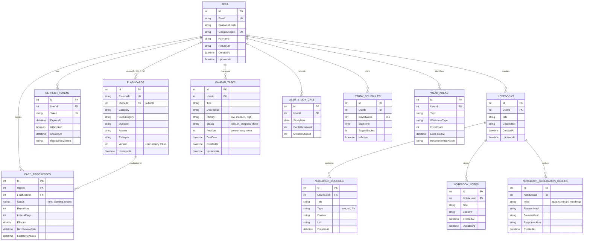
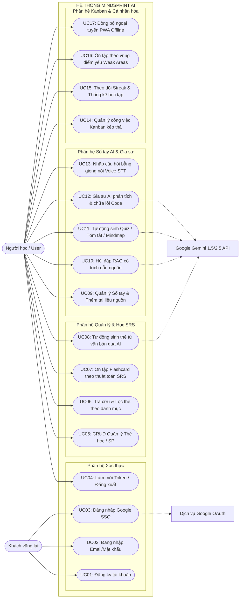
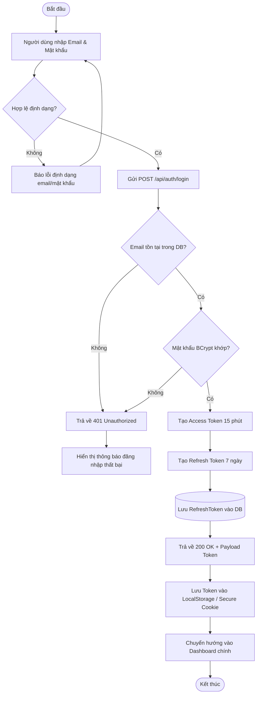
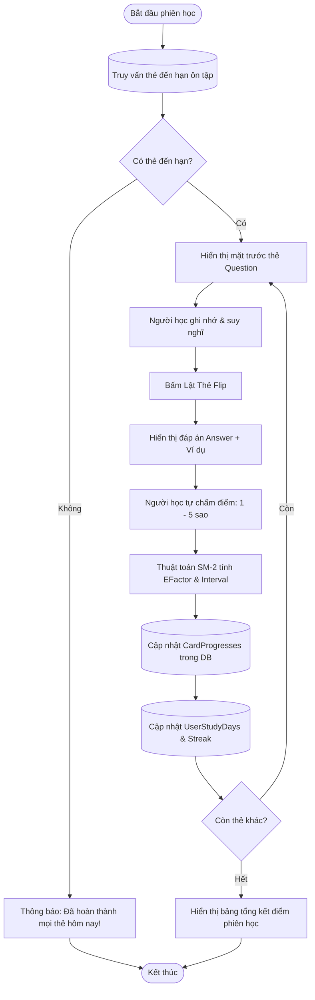
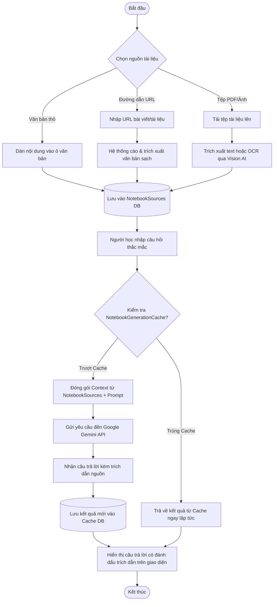
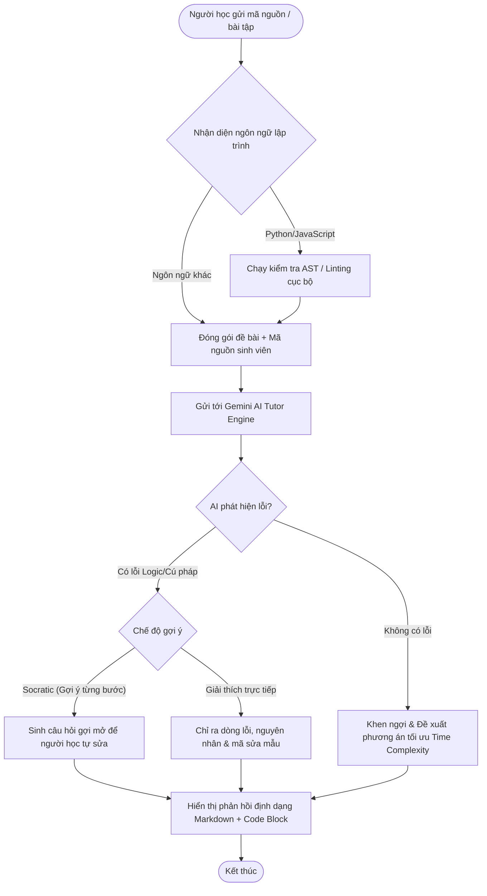
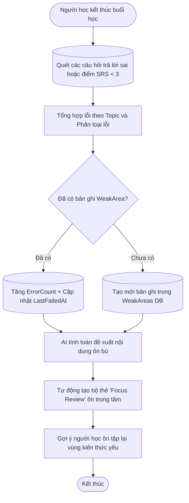
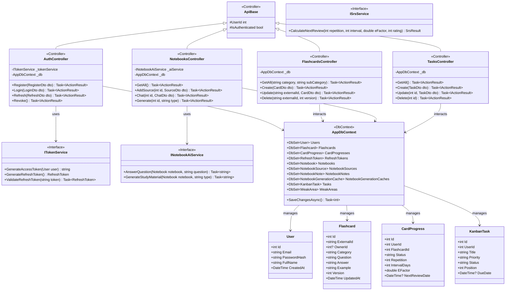

# BÁO CÁO DỰ ÁN CÔNG NGHỆ THÔNG TIN & CÔNG NGHỆ PHẦN MỀM
# ĐỀ TÀI: HỆ THỐNG QUẢN LÝ VÀ HỖ TRỢ HỌC TẬP THÔNG MINH — MINDSPRINT AI

---

* **Đơn vị đào tạo:** Khoa Công nghệ Thông tin
* **Dự án:** MindSprint AI (Spaced Repetition Flashcard, AI Notebook & RAG Study Cockpit)
* **Kho lưu trữ GitHub:** [https://github.com/tungtungsahul/MindSprint-AI-D-n](https://github.com/tungtungsahul/MindSprint-AI-D-n)
* **Bản triển khai trực tiếp (Live Production):**
  * **Frontend (Vercel):** [https://mindsprint-ai-d-n-frontend.vercel.app/](https://mindsprint-ai-d-n-frontend.vercel.app/)
  * **Backend API (Render Cloud):** [https://mindsprint-api-zyur.onrender.com](https://mindsprint-api-zyur.onrender.com)
* **Nhóm sinh viên thực hiện (5 thành viên):**
  1. **Nguyễn Trần Bảo Duy** (Nhóm trưởng / Backend Lead)
  2. **Đỗ Đình Phan Diễn** (Frontend & Auth Lead)
  3. **Vũ Đình Hùng** (UI Responsive & Audio / Speech AI)
  4. **Minh Chiến** (AI Notebook & Study Plan)
  5. **Tuấn Linh** (Database Architect & UML Specialist)

---

## MỤC LỤC
1. [1. Phát biểu bài toán](#1-phát-biểu-bài-toán)
2. [2. Phân tích & thiết kế](#2-phân-tích--thiết-kế)
   * [2.1. Thiết kế cơ sở dữ liệu (CSDL)](#21-thiết-kế-cơ-sở-dữ-liệu-csdl)
     * [2.1.1. Xác định thực thể](#211-xác-định-thực-thể)
     * [2.1.2. Xác định mối quan hệ](#212-xác-định-mối-quan-hệ)
     * [2.1.3. Chuẩn hóa 3NF (Third Normal Form)](#213-chuẩn-hóa-3nf-third-normal-form)
     * [2.1.4. Lược đồ thực thể - mối quan hệ (ERD)](#214-lược-đồ-thực-thể---mối-quan-hệ-erd)
     * [2.1.5. Lược đồ cơ sở dữ liệu quan hệ (Database Diagram)](#215-lược-đồ-cơ-sở-dữ-liệu-quan-hệ-database-diagram)
     * [2.1.6. Chi tiết các bảng dữ liệu (Data Dictionary / Tables)](#216-chi-tiết-các-bảng-dữ-liệu-data-dictionary--tables)
   * [2.2. Thiết kế hệ thống](#22-thiết-kế-hệ-thống)
     * [2.2.1. Sơ đồ Use Case tổng quát và phân rã](#221-sơ-đồ-use-case-tổng-quát-và-phân-rã)
     * [2.2.2. Bảng đặc tả Use Case chi tiết](#222-bảng-đặc-tả-use-case-chi-tiết)
     * [2.2.3. Sơ đồ hoạt động (7 Activity Diagrams + mô tả)](#223-sơ-đồ-hoạt-động-7-activity-diagrams--mô-tả)
     * [2.2.4. Sơ đồ lớp (Class Diagram theo mô hình MVC)](#224-sơ-đồ-lớp-class-diagram-theo-mô-hình-mvc)
     * [2.2.5. Sơ đồ triển khai hệ thống (Deployment Diagram)](#225-sơ-đồ-triển-khai-hệ-thống-deployment-diagram)
3. [3. Triển khai](#3-triển-khai)
   * [3.1. Triển khai Frontend (FE)](#31-triển-khai-frontend-fe)
   * [3.2. Triển khai Backend (BE)](#32-triển-khai-backend-be)
   * [3.3. Kiểm thử phần mềm (Testing)](#33-kiểm-thử-phần-mềm-testing)
4. [4. Kết quả & Hướng phát triển](#4-kết-quả--hướng-phát-triển)
   * [4.1. Kết quả đạt được](#41-kết-quả-đạt-được)
   * [4.2. Kết luận](#42-kết-luận)
   * [4.3. Hướng phát triển tương lai](#43-hướng-phát-triển-tương-lai)
5. [Tài liệu tham khảo](#tài-liệu-tham-khảo)

---

# 1. PHÁT BIỂU BÀI TOÁN

### 1.1. Bối cảnh và Tính cấp thiết của đề tài
Trong kỷ nguyên bùng nổ thông tin và chuyển đổi số giáo dục, người học (học sinh, sinh viên, người đi làm) phải đối mặt với khối lượng kiến thức khổng lồ. Tuy nhiên, các phương pháp học tập truyền thống bộc lộ nhiều hạn chế cốt lõi:
1. **Đường cong quên lãng (Ebbinghaus Forgetting Curve):** Não bộ con người quên tới 70% kiến thức mới nạp trong vòng 24-48 giờ nếu không được ôn tập có hệ thống.
2. **Thiếu tính cá nhân hóa:** Người học thường dàn trải thời gian ôn lại những kiến thức đã vững thay vì tập trung vào các "vùng điểm yếu" (Weak Areas).
3. **Phân mảnh công cụ học tập:** Hiện tại người học phải mở nhiều ứng dụng rời rạc: một ứng dụng tạo flashcard, một ứng dụng ghi chú tài liệu PDF, một chatbot AI để giải đáp bài tập, và một ứng dụng Kanban để quản lý lịch biểu học tập. Việc này làm giảm mạnh sự tập trung và gia tăng tải trọng nhận thức (Cognitive Load).

### 1.2. Mục tiêu của dự án
Dự án **MindSprint AI** hướng đến việc xây dựng một hệ thống phần mềm toàn diện theo mô hình **Study Cockpit** tích hợp 4 phân hệ trụ cột:
* **Hệ thống Quản lý & Học Flashcards SRS (Spaced Repetition System):** Áp dụng thuật toán lặp lại ngắt quãng SM-2 cải tiến, tự động tính toán thời điểm vàng ôn tập dựa trên hệ số độ dễ (Easiness Factor) và khoảng cách ngày ôn tập.
* **Sổ tay thông minh (AI Notebook & RAG):** Cho phép người học tải lên tài liệu học tập (văn bản, URL bài viết, tệp tin), tự động trích xuất ngữ cảnh, tóm tắt, tạo câu hỏi trắc nghiệm và hỏi đáp có trích dẫn nguồn dựa trên Google Gemini AI.
* **Gia sư ảo AI (AI Tutor & Code Analyzer):** Đóng vai trò là trợ giảng thông minh 24/7 giải thích kiến thức, gợi ý giải bài tập từng bước (Socratic Method), phân tích lỗi cú pháp và thuật toán mã nguồn (Python, JavaScript).
* **Quản lý công việc & Lập kế hoạch (Kanban & Study Planner):** Tổ chức nhiệm vụ học tập theo mô hình Agile/Kanban (To Do, In Progress, Done) tích hợp nhắc nhở lịch học và thống kê chuỗi ngày học liên tục (Study Streak).

### 1.3. Đối tượng sử dụng và Phạm vi nghiệp vụ
* **Đối tượng sử dụng chính:** Học sinh, sinh viên đại học, người học ngoại ngữ, lập trình viên và những cá nhân tự học có định hướng nâng cao năng lực.
* **Phạm vi hệ thống:**
  * Ứng dụng Web PWA (Progressive Web Application) hoạt động đa nền tảng (Desktop, Tablet, Mobile) và có cơ chế lưu trữ đệm ngoại tuyến (Offline Sync).
  * Web API chuẩn RESTful kiến trúc phân tầng (Layered Monolith / Clean Architecture) bảo mật qua chuẩn JSON Web Token (JWT) và Refresh Token Rotation.
  * Cơ sở dữ liệu quan hệ PostgreSQL chuẩn hóa 3NF đảm bảo tính toàn vẹn dữ liệu và hỗ trợ kiểm soát tương tranh lạc quan (Optimistic Concurrency Control).

---

# 2. PHÂN TÍCH & THIẾT KẾ

## 2.1. THIẾT KẾ CƠ SỞ DỮ LIỆU (CSDL)

### 2.1.1. Xác định thực thể (Entities)
Dựa trên phân tích yêu cầu nghiệp vụ, hệ thống bao gồm 12 thực thể chính:
1. **User (Người dùng):** Đại diện cho tài khoản người học trong hệ thống (email, mật khẩu băm, Google OAuth Subject, họ tên).
2. **Flashcard (Thẻ học / Sản phẩm tri thức):** Đại diện cho đơn vị thẻ kiến thức (câu hỏi, câu trả lời, ví dụ, phân loại danh mục, tác giả tạo).
3. **CardProgress (Tiến trình thẻ học SRS):** Đại diện cho trạng thái học tập của một User cụ thể đối với một Flashcard (độ dễ EFactor, số lần lặp lại Repetition, khoảng cách IntervalDays, ngày ôn kế tiếp NextReviewDate).
4. **RefreshToken (Mã làm mới phiên đăng nhập):** Lưu trữ mã xác thực gia hạn phiên làm việc và trạng thái thu hồi nhằm bảo vệ phiên người dùng.
5. **Notebook (Sổ tay học tập):** Không gian làm việc chứa tài liệu và ghi chú của người học theo môn học/chuyên đề.
6. **NotebookSource (Nguồn tài liệu sổ tay):** Tài liệu văn bản, tệp đính kèm hoặc URL bài viết được nạp vào sổ tay để cung cấp ngữ cảnh RAG cho AI.
7. **NotebookNote (Ghi chú sổ tay):** Các ghi chú do người học tự viết hoặc do AI sinh ra trong quá trình học.
8. **NotebookGenerationCache (Bộ nhớ đệm sinh nội dung AI):** Lưu trữ kết quả AI đã sinh (Quiz, Mindmap, Summary) theo mã băm yêu cầu và mã băm nguồn nhằm tối ưu chi phí gọi API và tăng tốc độ phản hồi.
9. **KanbanTask (Công việc học tập):** Công việc cần hoàn thành trên bảng Kanban (tiêu đề, mô tả, mức độ ưu tiên, trạng thái, thứ tự vị trí, hạn chót).
10. **UserStudyDay (Nhật ký ngày học):** Bản ghi đánh dấu ngày người dùng có hoạt động học tập nhằm tính toán Streak (chuỗi ngày học).
11. **StudySchedule (Lịch học định kỳ):** Kế hoạch học tập theo các ngày trong tuần và khung giờ quy định.
12. **WeakArea (Vùng kiến thức yếu):** Điểm ngữ pháp, từ vựng hoặc khái niệm mà người học thường xuyên trả lời sai, dùng để cá nhân hóa đề ôn tập.

---

### 2.1.2. Xác định mối quan hệ giữa các thực thể
* **User — Flashcard:** Quan hệ `0..1 : 0..N`. Một người dùng có thể sở hữu nhiều thẻ học tự tạo (`OwnerId`). Một thẻ học hệ thống dùng chung (System Deck) có `OwnerId = NULL`.
* **Flashcard — CardProgress:** Quan hệ `1 : 0..N`. Một thẻ học có thể được theo dõi tiến trình bởi nhiều người học khác nhau.
* **User — CardProgress:** Quan hệ `1 : 0..N`. Một người dùng có nhiều bản ghi tiến trình học cho các thẻ khác nhau. Cặp khóa `(UserId, FlashcardId)` là duy nhất (Unique Index) tạo nên mối quan hệ nhiều - nhiều ($N:M$) giữa `User` và `Flashcard` thông qua thực thể kết hợp `CardProgress`.
* **User — RefreshToken:** Quan hệ `1 : 0..N` (Cascade Delete khi xóa User).
* **User — Notebook:** Quan hệ `1 : 0..N`. Một người dùng có nhiều sổ tay học tập.
* **Notebook — NotebookSource:** Quan hệ `1 : 0..N` (Cascade Delete khi xóa Notebook).
* **Notebook — NotebookNote:** Quan hệ `1 : 0..N` (Cascade Delete khi xóa Notebook).
* **Notebook — NotebookGenerationCache:** Quan hệ `1 : 0..N` (Cascade Delete khi xóa Notebook).
* **User — KanbanTask:** Quan hệ `1 : 0..N`. Một người dùng sở hữu nhiều công việc trên bảng Kanban.
* **User — UserStudyDay:** Quan hệ `1 : 0..N`. Cặp `(UserId, StudyDate)` là duy nhất.
* **User — StudySchedule:** Quan hệ `1 : 0..N`. Cặp `(UserId, DayOfWeek)` có đánh chỉ mục.
* **User — WeakArea:** Quan hệ `1 : 0..N` (Ràng buộc Foreign Key thực, Cascade Delete).

---

### 2.1.3. Chuẩn hóa CSDL đạt dạng chuẩn 3 (3NF)

Quá trình chuẩn hóa đảm bảo cơ sở dữ liệu không bị dư thừa dữ liệu (redundancy), tránh dị thường khi thêm (insert anomaly), sửa (update anomaly) và xóa (delete anomaly):

#### Bước 1: Dạng chuẩn 1 (1NF - First Normal Form)
* **Quy tắc:** Mỗi thuộc tính của quan hệ phải có giá trị nguyên tố (atomic value), không chứa thuộc tính lặp (repeating groups) hoặc danh sách đa trị trong một ô.
* **Áp dụng vào hệ thống:**
  * Bảng `Flashcard` trước khi chuẩn hóa có thể chứa danh sách nhiều ví dụ hoặc nhiều tags trong một chuỗi định dạng phẩy `tags = "math, algebra, basic"`.
  * Chuẩn hóa: Tách `Category` và `SubCategory` thành các trường thuộc tính nguyên tố riêng biệt. Thuộc tính `Question`, `Answer`, `Example` đều là các chuỗi ký tự nguyên tố duy nhất.
  * Các ghi chú trong sổ tay không lưu dồn thành một mảng JSON mà được phân tách thành từng dòng bản ghi độc lập trong thực thể con `NotebookNotes` và `NotebookSources`.
  * Khóa chính cho mỗi quan hệ được xác định rõ ràng thông qua định danh duy nhất `Id` (Surrogate Primary Key).

#### Bước 2: Dạng chuẩn 2 (2NF - Second Normal Form)
* **Quy tắc:** Quan hệ đã đạt 1NF và mọi thuộc tính không khóa (non-prime attribute) phải **phụ thuộc hàm đầy đủ (fully functionally dependent)** vào toàn bộ khóa chính, không được phụ thuộc vào một phần của khóa chính (loại bỏ partial dependencies).
* **Áp dụng vào hệ thống:**
  * Xét mối quan hệ giữa người học và thẻ học: Cần lưu trạng thái ôn tập (Repetition, IntervalDays, EFactor, NextReviewDate).
  * Nếu ta đặt các thuộc tính trên chung vào bảng `Flashcards` cùng với `UserId`, khóa chính sẽ là `(UserId, FlashcardId)`. Khi đó, các thuộc tính như `Question`, `Answer`, `Category` chỉ phụ thuộc vào `FlashcardId` chứ không phụ thuộc vào `UserId` $\Rightarrow$ Vi phạm 2NF.
  * Giải pháp chuẩn hóa 2NF: Tách thành 2 quan hệ riêng biệt:
    * `Flashcard(Id, ExternalId, Category, SubCategory, Question, Answer, Example, OwnerId, Version)` trong đó mọi thuộc tính phụ thuộc hàm hoàn toàn vào `Id`.
    * `CardProgress(Id, UserId, FlashcardId, Status, Repetition, IntervalDays, EFactor, NextReviewDate)` trong đó các thuộc tính tiến trình phụ thuộc vào cặp `(UserId, FlashcardId)`.

#### Bước 3: Dạng chuẩn 3 (3NF - Third Normal Form)
* **Quy tắc:** Quan hệ đã đạt 2NF và không có thuộc tính không khóa nào **phụ thuộc bắc cầu (transitively dependent)** vào khóa chính thông qua một thuộc tính không khóa khác (mọi phụ thuộc hàm $X \rightarrow Y$ thì $X$ phải là siêu khóa hoặc $Y$ là thuộc tính khóa).
* **Áp dụng vào hệ thống:**
  * Xét bảng `Notebook`: Nếu lưu thông tin `Notebook(Id, UserId, UserName, UserEmail, Title, CreatedAt)`, ta có phụ thuộc hàm:
    $$Id \rightarrow UserId \quad \text{và} \quad UserId \rightarrow (UserName, UserEmail)$$
    Điều này dẫn đến phụ thuộc bắc cầu $Id \rightarrow (UserName, UserEmail)$, gây dư thừa dữ liệu và dị thường khi người dùng đổi email.
  * Giải pháp chuẩn hóa 3NF: Loại bỏ các thuộc tính của người dùng ra khỏi `Notebook`, chỉ giữ lại khóa ngoại `UserId`:
    * `User(Id, Email, PasswordHash, FullName, GoogleSubject)`
    * `Notebook(Id, UserId, Title, Description, CreatedAt, UpdatedAt)`
  * Tương tự, bảng `CardProgress` không lưu `Question` hay `Answer` của thẻ, bảng `KanbanTask` chỉ lưu `UserId` mà không lặp lại bất kỳ thông tin nào của tài khoản.
  * **Kết luận:** Toàn bộ 12 bảng trong cơ sở dữ liệu đều đạt chuẩn **3NF**, đảm bảo tối ưu hóa dung lượng lưu trữ và tính nhất quán dữ liệu tối đa.

---

### 2.1.4. Lược đồ thực thể - mối quan hệ (ERD)



---

### 2.1.5. Lược đồ cơ sở dữ liệu quan hệ (Database Diagram)

```
+---------------------------------------------------------------------------------------------------+
|                                      DATABASE SCHEMA DIAGRAM                                      |
+---------------------------------------------------------------------------------------------------+

   +---------------------+             +-------------------------+
   |        USERS        | 1         * |      REFRESH_TOKENS     |
   +---------------------+-------------+-------------------------+
   | PK  Id              |             | PK  Id                  |
   | UK  Email           |             | FK  UserId              |
   |     PasswordHash    |             | UK  Token               |
   | UK* GoogleSubject   |             |     ExpiresAt           |
   |     FullName        |             |     IsRevoked           |
   +----------+----------+             +-------------------------+
              | 1
              |
              +-------------------------+ 1
              |                         |
              | *                       | *
   +----------v----------+   +----------v----------+             +-------------------------------+
   |      NOTEBOOKS      |   |     KANBAN_TASKS    |             |        CARD_PROGRESSES        |
   +---------------------+   +---------------------+             +-------------------------------+
   | PK  Id              |   | PK  Id              |             | PK  Id                        |
   | FK  UserId          |   | FK  UserId          |        +----+ FK  UserId                    |
   |     Title           |   |     Title           |        |    | FK  FlashcardId               |
   |     CreatedAt       |   |     Status          |        |    | UK (UserId, FlashcardId)      |
   +-----+--------+------+   |     Position        |        |    |     IntervalDays, EFactor     |
         | 1      | 1        +---------------------+        |    +---------------+---------------+
         |        |                                         |                    | *
         | *      +-------------------+ *                   |                    |
   +-----v----------------+   +-------v-----------------+   |                    | 1
   |   NOTEBOOK_SOURCES   |   |     NOTEBOOK_NOTES      |   |        +-----------v-----------+
   +----------------------+   +-------------------------+   |        |      FLASHCARDS       |
   | PK  Id               |   | PK  Id                  |   |        +-----------------------+
   | FK  NotebookId       |   | FK  NotebookId          |   |        | PK  Id                |
   |     Title, Content   |   |     Title, Content      |   |        | UK  ExternalId        |
   +----------------------+   +-------------------------+   |        | FK* OwnerId (nullable)|
                                                            |        |     Category, Question|
                                                            |        |     Answer, Example   |
   +---------------------+             +--------------------+---+    |     Version (OCC)     |
   |      WEAK_AREAS     | *         1 |    USER_STUDY_DAYS     |    +-----------------------+
   +---------------------+-------------+------------------------+
   | PK  Id              |             | PK  Id                 |
   | FK  UserId          |             | FK  UserId             |
   |     Topic, ErrCount |             | UK (UserId, StudyDate) |
   +---------------------+             +------------------------+
```

---

### 2.1.6. Chi tiết các bảng dữ liệu (Data Dictionary / Tables)

#### Bảng 1: `Users` (Người dùng)
| Tên cột | Kiểu dữ liệu | Ràng buộc | Giá trị mặc định | Diễn giải |
| :--- | :--- | :--- | :--- | :--- |
| `Id` | `INTEGER` | PK, Identity | Tự tăng | Khóa chính duy nhất định danh người dùng |
| `Email` | `VARCHAR(256)` | NOT NULL, UNIQUE | | Email dùng để đăng nhập và nhận thông báo |
| `PasswordHash` | `TEXT` | NULL | NULL | Mật khẩu được băm bảo mật bằng BCrypt/Argon2 |
| `GoogleSubject` | `VARCHAR(255)` | UNIQUE (Filtered) | NULL | Định danh sub của người dùng từ Google OAuth 2.0 |
| `FullName` | `VARCHAR(128)` | NULL | NULL | Họ và tên hiển thị của người học |
| `PictureUrl` | `TEXT` | NULL | NULL | Đường dẫn ảnh đại diện avatar |
| `CreatedAt` | `TIMESTAMPTZ` | NOT NULL | `NOW()` | Thời điểm khởi tạo tài khoản |
| `UpdatedAt` | `TIMESTAMPTZ` | NOT NULL | `NOW()` | Thời điểm cập nhật thông tin gần nhất |

#### Bảng 2: `Flashcards` (Thẻ học / Sản phẩm tri thức)
| Tên cột | Kiểu dữ liệu | Ràng buộc | Giá trị mặc định | Diễn giải |
| :--- | :--- | :--- | :--- | :--- |
| `Id` | `INTEGER` | PK, Identity | Tự tăng | Khóa chính nội bộ hệ thống |
| `ExternalId` | `VARCHAR(64)` | NOT NULL, UNIQUE | UUID v4 | Mã công khai dùng cho API và URL chia sẻ |
| `OwnerId` | `INTEGER` | FK $\rightarrow$ Users(Id), NULL | NULL | Tài khoản chủ sở hữu (NULL nếu là thẻ hệ thống chung) |
| `Category` | `VARCHAR(64)` | NOT NULL | | Danh mục chính (Vocabulary, Programming, Science...) |
| `SubCategory` | `VARCHAR(64)` | NULL | NULL | Danh mục phụ/chủ đề cụ thể |
| `Question` | `TEXT` | NOT NULL | | Mặt trước của thẻ (Câu hỏi / Từ vựng / Khái niệm) |
| `Answer` | `TEXT` | NOT NULL | | Mặt sau của thẻ (Câu trả lời / Định nghĩa / Nghĩa từ) |
| `Example` | `TEXT` | NULL | NULL | Câu ví dụ minh họa hoặc ngữ cảnh áp dụng |
| `Version` | `INTEGER` | NOT NULL | 1 | Token tương tranh lạc quan (Optimistic Locking) |
| `UpdatedAt` | `TIMESTAMPTZ` | NOT NULL | `NOW()` | Thời điểm sửa đổi thẻ gần nhất |

#### Bảng 3: `CardProgresses` (Tiến trình học Spaced Repetition)
| Tên cột | Kiểu dữ liệu | Ràng buộc | Giá trị mặc định | Diễn giải |
| :--- | :--- | :--- | :--- | :--- |
| `Id` | `INTEGER` | PK, Identity | Tự tăng | Khóa chính bản ghi tiến trình |
| `UserId` | `INTEGER` | NOT NULL, Index | | Người học sở hữu tiến trình |
| `FlashcardId` | `INTEGER` | FK $\rightarrow$ Flashcards(Id) | | Thẻ được theo dõi tiến trình |
| `Status` | `VARCHAR(32)` | NOT NULL | `'new'` | Trạng thái: `new`, `learning`, `review`, `mastered` |
| `Repetition` | `INTEGER` | NOT NULL | 0 | Số lần đã hoàn thành ôn tập liên tiếp đúng |
| `IntervalDays` | `INTEGER` | NOT NULL | 1 | Khoảng cách số ngày cho lần ôn tập kế tiếp |
| `EFactor` | `DOUBLE PRECISION`| NOT NULL | 2.5 | Hệ số độ dễ Easiness Factor (SM-2: tối thiểu 1.3) |
| `NextReviewDate`| `TIMESTAMPTZ` | NULL | NULL | Mốc thời gian chính xác cần kích hoạt ôn lại |
| `LastReviewDate`| `TIMESTAMPTZ` | NULL | NULL | Mốc thời gian hoàn thành lần ôn tập gần nhất |

#### Bảng 4: `RefreshTokens` (Mã phiên gia hạn)
| Tên cột | Kiểu dữ liệu | Ràng buộc | Giá trị mặc định | Diễn giải |
| :--- | :--- | :--- | :--- | :--- |
| `Id` | `INTEGER` | PK, Identity | Tự tăng | Khóa chính |
| `UserId` | `INTEGER` | FK $\rightarrow$ Users(Id), CASCADE | | Tài khoản người dùng sở hữu token |
| `Token` | `VARCHAR(512)`| NOT NULL, UNIQUE | | Chuỗi mã ngẫu nhiên bảo mật cao |
| `ExpiresAt` | `TIMESTAMPTZ` | NOT NULL | | Thời điểm hết hạn hiệu lực của Refresh Token (7 ngày) |
| `IsRevoked` | `BOOLEAN` | NOT NULL | FALSE | Trạng thái bị thu hồi/vô hiệu hóa |
| `CreatedAt` | `TIMESTAMPTZ` | NOT NULL | `NOW()` | Thời điểm cấp phát token |
| `ReplacedByToken`| `VARCHAR(512)`| NULL | NULL | Token kế thừa dùng cho cơ chế Token Rotation |

#### Bảng 5: `KanbanTasks` (Công việc học tập)
| Tên cột | Kiểu dữ liệu | Ràng buộc | Giá trị mặc định | Diễn giải |
| :--- | :--- | :--- | :--- | :--- |
| `Id` | `INTEGER` | PK, Identity | Tự tăng | Khóa chính công việc |
| `UserId` | `INTEGER` | NOT NULL, Index | | Tài khoản sở hữu công việc |
| `Title` | `VARCHAR(256)` | NOT NULL | | Tên/Tiêu đề công việc cần làm |
| `Description` | `TEXT` | NULL | NULL | Chi tiết mô tả nhiệm vụ |
| `Priority` | `VARCHAR(32)` | NOT NULL | `'medium'` | Mức độ ưu tiên: `low`, `medium`, `high` |
| `Status` | `VARCHAR(32)` | NOT NULL | `'todo'` | Trạng thái cột: `todo`, `in_progress`, `done` |
| `Position` | `INTEGER` | NOT NULL | 0 | Thứ tự sắp xếp trong cột Kanban |
| `DueDate` | `TIMESTAMPTZ` | NULL | NULL | Hạn chót hoàn thành nhiệm vụ |
| `CreatedAt` | `TIMESTAMPTZ` | NOT NULL | `NOW()` | Ngày tạo task |
| `UpdatedAt` | `TIMESTAMPTZ` | NOT NULL | `NOW()` | Ngày cập nhật task |

---

## 2.2. THIẾT KẾ HỆ THỐNG

### 2.2.1. Sơ đồ Use Case tổng quát và phân rã



---

### 2.2.2. Bảng đặc tả Use Case chi tiết

#### Bảng đặc tả UC05: Quản lý Thẻ học (CRUD Sản phẩm / Flashcard)
* **Tên Use Case:** CRUD Quản lý Thẻ học / Sản phẩm (Create, Read, Update, Delete Flashcard)
* **Tác nhân chính:** Người học (User đã đăng nhập thành công)
* **Tiền điều kiện (Preconditions):** Người dùng đã đăng nhập, sở hữu Access Token JWT hợp lệ.
* **Hậu điều kiện (Postconditions):** Thẻ học được thêm/sửa/xóa thành công trong DB, phiên bản `Version` được tăng lên và đồng bộ tức thời với giao diện người dùng.
* **Luồng sự kiện chính (Main Flow):**
  1. Người học truy cập phân hệ Thư viện thẻ (Flashcard Studio).
  2. Hệ thống gửi yêu cầu `GET /api/flashcards`, lấy toàn bộ thẻ hệ thống và thẻ do người học tạo.
  3. Người học chọn thao tác:
     * **Thêm mới (Create):** Nhập danh mục, câu hỏi, câu trả lời, ví dụ $\rightarrow$ Nhấn "Lưu thẻ" $\rightarrow$ Frontend gửi `POST /api/flashcards`.
     * **Chỉnh sửa (Update):** Chọn thẻ cần sửa, chỉnh sửa nội dung $\rightarrow$ Gửi `PUT /api/flashcards/{externalId}` kèm `version` hiện tại.
     * **Xóa (Delete):** Nhấn biểu tượng thùng rác $\rightarrow$ Xác nhận $\rightarrow$ Gửi `DELETE /api/flashcards/{externalId}`.
  4. Backend kiểm tra quyền sở hữu (`OwnerId == currentUserId`), xác thực phiên bản kiểm soát tương tranh.
  5. Backend cập nhật PostgreSQL và trả về phản hồi thành công `200 OK` hoặc `204 NoContent`.
  6. Frontend cập nhật danh sách thẻ trên UI và lưu vào bộ nhớ cache client.
* **Luồng ngoại lệ (Alternative/Exception Flows):**
  * **E1 - Xung đột phiên bản (Concurrency Conflict):** Nếu thẻ đã bị sửa bởi phiên đăng nhập khác, backend trả về `409 Conflict`. Hệ thống hiển thị thông báo: "Dữ liệu thẻ đã thay đổi ở thiết bị khác, vui lòng tải lại" và đưa ra nội dung mới nhất của máy chủ để đối chiếu.
  * **E2 - Không có quyền thao tác:** Người dùng cố gắng sửa/xóa thẻ mặc định của hệ thống (`OwnerId == null`) $\rightarrow$ Backend trả về `403 Forbidden` hoặc `404 NotFound`.

#### Bảng đặc tả UC07: Ôn tập Flashcard theo thuật toán SRS (Spaced Repetition)
* **Tên Use Case:** Học & Đánh giá thẻ theo thuật toán Spaced Repetition (SuperMemo SM-2)
* **Tác nhân chính:** Người học (User)
* **Tiền điều kiện:** Có ít nhất một thẻ đến hạn ôn tập (`NextReviewDate <= DateTime.UtcNow`).
* **Hậu điều kiện:** `CardProgress` được tính toán lại: cập nhật `EFactor`, `IntervalDays`, `Repetition` và mốc `NextReviewDate` mới.
* **Luồng sự kiện chính:**
  1. Người học vào giao diện "Luyện tập" (Study Session).
  2. Hệ thống hiển thị câu hỏi mặt trước của thẻ.
  3. Người học tự nhẩm đáp án và nhấn "Lật thẻ" (Flip Card) để xem đáp án đúng và ví dụ.
  4. Người học tự chấm điểm mức độ nhớ từ thang 1 đến 5 (1: Quên hoàn toàn, 2: Nhớ khó khăn, 3: Nhớ có gợi ý, 4: Nhớ tốt, 5: Nhớ hoàn hảo).
  5. Hệ thống gửi yêu cầu `POST /api/review/{flashcardId}` với điểm đánh giá `Rating`.
  6. Backend gọi `SrsService` áp dụng thuật toán SM-2:
     $$EF' = EF + (0.1 - (5 - q) \times (0.08 + (5 - q) \times 0.02))$$
     và tính toán khoảng cách số ngày ôn tập kế tiếp $I(n)$.
  7. Backend lưu kết quả vào bảng `CardProgresses`, đồng thời ghi nhận ngày học vào `UserStudyDays` để tính Streak.
  8. Hệ thống chuyển sang thẻ kế tiếp trong phiên học.

---

### 2.2.3. Sơ đồ hoạt động (7 Activity Diagrams + Mô tả chi tiết)

#### Biểu đồ 1: Quy trình Đăng ký / Đăng nhập & Xác thực JWT với Token Rotation


* **Mô tả:** Quy trình bảo mật áp dụng mô hình phân tách Token: Access Token có vòng đời ngắn (15 phút) nhằm hạn chế rủi ro lộ mã truy cập; Refresh Token có thời hạn 7 ngày được lưu trữ an toàn trong DB. Mỗi khi Access Token hết hạn, client gửi Refresh Token để thực hiện quy trình **Token Rotation** (vô hiệu hóa mã cũ và cấp phát cặp token mới duy nhất).

---

#### Biểu đồ 2: Quy trình CRUD Quản lý Thẻ học / Sản phẩm với Concurrency Control

```mermaid
flowchart TD
    Start([Bắt đầu]) --> SelectAction{Chọn thao tác CRUD}
    
    SelectAction -- Thêm mới --> InputCard[Nhập thông tin Category, Q, A, Example]
    InputCard --> PostCard[Gửi POST /api/flashcards]
    PostCard --> InsertDB[(Thêm Flashcard vào DB với Version=1)]
    InsertDB --> ResCreate[Trả về 200 OK + Id thẻ]
    
    SelectAction -- Chỉnh sửa --> LoadEdit[Mở Modal sửa & nạp Version hiện tại]
    LoadEdit --> SubmitEdit[Gửi PUT /api/flashcards/{id} kèm Version]
    SubmitEdit --> CheckOCC{Version gửi lên == Version DB?}
    CheckOCC -- Khác nhau --> ResConflict[Trả về 409 Conflict + Server Data]
    ResConflict --> AlertUser[Cảnh báo xung đột & nạp dữ liệu mới]
    CheckOCC -- Bằng nhau --> UpdateDB[(Cập nhật nội dung & Tăng Version + 1)]
    UpdateDB --> ResUpdate[Trả về 200 OK + Updated Version]
    
    SelectAction -- Xóa thẻ --> ConfirmDel{Người dùng xác nhận xóa?}
    ConfirmDel -- Hủy --> Cancel[Hủy bỏ thao tác]
    ConfirmDel -- Đồng ý --> SendDel[Gửi DELETE /api/flashcards/{id}]
    SendDel --> DeleteDB[(Xóa thẻ khỏi DB)]
    DeleteDB --> ResDel[Trả về 204 No Content]
    
    ResCreate --> RefreshUI[Cập nhật danh sách trên giao diện] --> End([Kết thúc])
    ResUpdate --> RefreshUI
    ResDel --> RefreshUI
```
* **Mô tả:** Đảm bảo toàn vẹn dữ liệu khi nhiều tab hoặc nhiều thiết bị cùng chỉnh sửa một sản phẩm/thẻ học. Cơ chế Optimistic Concurrency Control (OCC) sử dụng cột `Version` để chặn đứng hiện tượng Lost Update (ghi đè dữ liệu mà không hay biết).

---

#### Biểu đồ 3: Chu trình Luyện tập & Đánh giá theo thuật toán Spaced Repetition (SRS)


* **Mô tả:** Thuật toán SM-2 điều chỉnh khoảng cách ôn tập tự động: nếu người học nhớ tốt ($q \ge 4$), khoảng cách ôn tập sẽ tăng theo cấp số nhân ($I_1 = 1, I_2 = 6, I_n = I_{n-1} \times EF$); nếu quên ($q < 3$), chuỗi lặp lại bị reset về ngày đầu tiên để người học củng cố lại kiến thức.

---

#### Biểu đồ 4: Quy trình Sổ tay AI — Nạp tài liệu & Hỏi đáp RAG có trích dẫn nguồn


* **Mô tả:** Kết hợp kỹ thuật RAG (Retrieval-Augmented Generation) cục bộ: chỉ cho phép AI trả lời dựa trên những nguồn tài liệu đã được nạp vào sổ tay, loại bỏ hoàn toàn hiện tượng "ảo giác" (hallucination) của mô hình ngôn ngữ lớn, đồng thời lưu cache băm SHA-256 để tối ưu hiệu năng.

---

#### Biểu đồ 5: Gia sư AI — Phân tích bài tập & Phát hiện lỗi lập trình


* **Mô tả:** Hệ thống phân tích code và giải bài tập theo phương pháp đối thoại Socratic: không cung cấp đáp án ngay lập tức mà phân tích lỗi theo từng tầng, định hướng người học tự tìm ra bản chất vấn đề.

---

#### Biểu đồ 6: Quản lý công việc Kanban (Kéo thả & Kiểm soát thứ tự)

```mermaid
flowchart TD
    Start([Mở Bảng Kanban]) --> FetchTasks[(Lấy danh sách KanbanTasks theo UserId)]
    FetchTasks --> RenderColumns[Hiển thị 3 cột: To Do | In Progress | Done]
    RenderColumns --> UserDrag[Người học kéo thẻ Task từ cột này sang cột khác]
    UserDrag --> DropCard[Thả thẻ vào vị trí Position mới]
    DropCard --> OptimisticUI[Cập nhật UI cục bộ ngay lập tức]
    OptimisticUI --> SendPatch[Gửi PATCH /api/tasks/{id} với Status & Position mới]
    SendPatch --> UpdateTaskDB[(Cập nhật KanbanTasks trong DB)]
    UpdateTaskDB --> CheckSuccess{Lưu thành công?}
    CheckSuccess -- Thành công --> AckSuccess[Hoàn tất đồng bộ] --> End([Kết thúc])
    CheckSuccess -- Thất bại/Lỗi mạng --> RollbackUI[Hoàn tác vị trí thẻ về trạng thái cũ]
    RollbackUI --> ShowErrorToast[Báo lỗi không thể cập nhật công việc] --> End
```
* **Mô tả:** Triển khai mô hình Optimistic UI Updates: phản hồi thao tác kéo thả của người dùng với độ trễ 0ms trên giao diện, sau đó gửi đồng bộ bất đồng bộ xuống backend; tự động rollback nếu xảy ra sự cố mất kết nối mạng.

---

#### Biểu đồ 7: Cá nhân hóa lộ trình dựa trên Phân tích điểm yếu (Weak Areas)


* **Mô tả:** Hệ thống tự động gom cụm các câu hỏi/thẻ mà người học hay nhầm lẫn nhất, gán nhãn mức độ nghiêm trọng và tạo bộ ôn tập cá nhân hóa nhằm khắc phục lỗ hổng kiến thức đúng lúc.

---

### 2.2.4. Sơ đồ lớp (Class Diagram theo mô hình MVC / Phân tầng)



---

### 2.2.5. Sơ đồ triển khai hệ thống (Deployment Diagram)

```mermaid
flowchart TB
    subgraph Client_Tier ["TẦNG THIẾT BỊ NGƯỜI DÙNG (CLIENT TIER)"]
        Browser["Trình duyệt Web (Chrome, Edge, Safari, Firefox)"]
        PWA["PWA Client App (Service Worker + Cache + LocalStorage)"]
    end

    subgraph CDN_Frontend ["HẠ TẦNG FRONTEND HOSTING (VERCEL EDGE NETWORK)"]
        VercelCDN["Vercel Global CDN (SSL / HTTP/2)"]
        StaticAssets["Static Bundle: HTML5 / CSS3 / Vanilla JS / Icons"]
    end

    subgraph Backend_Cloud ["HẠ TẦNG DỊCH VỤ MÁY CHỦ (RENDER CLOUD)"]
        DockerContainer["Docker Container: ASP.NET Core 8 Web API"]
        KestrelServer["Kestrel High-Performance Web Server"]
        Middleware["JWT Middleware / CORS / Rate Limiting / Swagger"]
        AppControllers["Controllers & Business Services (EF Core 8)"]
    end

    subgraph Database_Tier ["HẠ TẦNG DỮ LIỆU (MANAGED POSTGRESQL CLUSTER)"]
        PostgresDB[("PostgreSQL 17 Managed Instance\n(Connection Pooling, Automated Backups, SSL)")]
    end

    subgraph External_Services ["DỊCH VỤ NGOẠI VI ĐÁM MÂY (EXTERNAL APIS)"]
        GoogleAuthAPI["Google OAuth 2.0 Identity Platform"]
        GeminiCloudAPI["Google Cloud Gemini 1.5 / 2.5 Flash API"]
    end

    Browser <--> |HTTPS / WSS| VercelCDN
    PWA <--> |Service Worker Cache| StaticAssets
    VercelCDN --> StaticAssets

    Browser <--> |RESTful HTTPS / Bearer JWT| KestrelServer
    KestrelServer --> Middleware --> AppControllers

    AppControllers <--> |Npgsql Connection Pool (TCP 5432)| PostgresDB
    AppControllers <--> |HTTPS REST / JSON| GeminiCloudAPI
    AppControllers <--> |OAuth Token Validation| GoogleAuthAPI
```

---

# 3. TRIỂN KHAI

## 3.1. TRIỂN KHAI FRONTEND (FE)
* **Công nghệ chủ đạo:** HTML5 Semantic, Modern CSS3 (CSS Variables, Flexbox/Grid responsive), Vanilla JavaScript ES6+ Module hóa không phụ thuộc framework nặng, giúp đạt tốc độ tải trang cực đại.
* **Giao diện Study Cockpit:** Thiết kế tone màu hiện đại (kem/xanh chanh/xám than), phân bổ bố cục trực quan với Sidebar điều hướng, Topbar hiển thị trạng thái Streak & Avatar người dùng, và vùng Canvas nội dung linh hoạt.
* **Tích hợp Web Speech API:** Hỗ trợ nhập liệu bằng giọng nói tiếng Việt (Speech-to-Text) giúp người học trao đổi trực tiếp với Sổ tay và Gia sư AI mà không cần gõ bàn phím.
* **Tiến trình PWA & Lưu trữ Offline:** Tích hợp `manifest.json` và Service Worker để lưu cache các tài nguyên tĩnh; khi mất mạng (offline), ứng dụng tự chuyển đổi đọc/ghi dữ liệu tạm thời vào `localStorage`, sẵn sàng đồng bộ ngược lên server khi có kết nối trở lại.

## 3.2. TRIỂN KHAI BACKEND (BE)
* **Nền tảng công nghệ:** Microsoft .NET 8.0 Web API (C#), ASP.NET Core Kestrel Server.
* **Truy xuất dữ liệu:** Entity Framework Core 8 với nhà cung cấp `Npgsql.EntityFrameworkCore.PostgreSQL`. Hỗ trợ Code-First Migrations, tự động áp dụng cấu trúc bảng khi khởi động ứng dụng.
* **Bảo mật & Phân quyền:**
  * JWT Bearer Token với thuật toán ký `HmacSha256`.
  * Cơ chế Refresh Token Rotation và Blacklist thu hồi phiên.
  * Phân lập dữ liệu triệt để: Mọi truy vấn đều lọc tự động theo `UserId` của người đăng nhập.
* **Tích hợp Trí tuệ nhân tạo:** Tích hợp Google Gemini REST API / SDK, quản lý prompt template chặt chẽ, hỗ trợ streaming kết quả và băm cache nội dung.

## 3.3. KIỂM THỬ PHẦN MỀM (TESTING)
Hệ thống được kiểm thử đa tầng nghiêm ngặt với các nhóm bài test:
1. **Kiểm thử đơn vị (Unit Tests):** Kiểm tra tính đúng đắn của thuật toán SM-2 (`SrsServiceTests`), logic mã hóa mật khẩu và tạo token.
2. **Kiểm thử tích hợp (Integration Tests):** Bộ test tự động bằng Python (`pytest`) với 4 tầng (Tier 1: Feature Coverage, Tier 2: Boundary & Corner Cases, Tier 3: Cross-Feature, Tier 4: Real-World Scenarios).
3. **Kiểm thử trình duyệt End-to-End (E2E):** Sử dụng Playwright / CJS để mô phỏng tương tác người dùng thực tế trên giao diện web, kiểm tra kéo thả Kanban và thao tác ôn thẻ.
4. **Kiểm thử phi chức năng (NFR Verification):**
   * **NFR-01 (Hiệu năng):** Đo lường Web Vitals (LCP < 2.5s, FID < 100ms, CLS < 0.1).
   * **NFR-02 (Tải & Giới hạn tài nguyên):** Chạy kiểm thử chịu tải với Autocannon/k6 đạt trên 500 requests/giây ở mức ổn định.
   * **NFR-03 (Phân lập tài khoản):** Đảm bảo 100% người dùng A không thể đọc/sửa/xóa thẻ học hoặc sổ tay của người dùng B.
   * **NFR-07 (Tương tranh Optimistic Locking):** 20/20 kịch bản ghi đè đồng thời đều kích hoạt đúng mã lỗi `409 Conflict`.
   * **NFR-11 (Khả năng hoạt động ngoại tuyến):** Ứng dụng tiếp tục hoạt động mượt mà khi ngắt kết nối mạng thông qua PWA Service Worker.

---

# 4. KẾT QUẢ & HƯỚNG PHÁT TRIỂN

## 4.1. KẾT QUẢ ĐẠT ĐƯỢC
* **Sản phẩm hoàn chỉnh:** Đã triển khai thành công phiên bản v0.2.0 hoàn thiện cả 4 phân hệ chính (Flashcards SRS, AI Notebook, AI Tutor, Kanban).
* **Môi trường Live Production hoạt động ổn định:**
  * Frontend: [https://mindsprint-ai-d-n-frontend.vercel.app/](https://mindsprint-ai-d-n-frontend.vercel.app/)
  * Backend API: [https://mindsprint-api-zyur.onrender.com](https://mindsprint-api-zyur.onrender.com)
* **Kho dữ liệu chuẩn:** Seed sẵn thư viện 1.814 thẻ từ vựng Oxford phân loại theo chủ đề và độ khó.

## 4.2. KẾT LUẬN
Dự án MindSprint AI đã giải quyết thành công bài toán tối ưu hóa việc ghi nhớ và tự chủ học tập của sinh viên. Hệ thống kết hợp hài hòa giữa cơ sở lý thuyết khoa học não bộ (Spaced Repetition) và sức mạnh công nghệ đột phá của Generative AI, mang đến một không gian học tập tập trung, thông minh và tiện ích. Toàn bộ quy trình phân tích, thiết kế CSDL 3NF, kiến trúc UML MVC và kiểm thử tự động đều được thực hiện bài bản và đạt chuẩn kỹ nghệ phần mềm.

## 4.3. HƯỚNG PHÁT TRIỂN TƯƠNG LAI
1. **Phát triển ứng dụng di động Native (React Native / Flutter):** Tận dụng tối đa phần cứng di động để tối ưu trải nghiệm thông báo nhắc học theo giờ sinh học.
2. **Mở rộng tính năng học nhóm (Social & Collaborative Learning):** Cho phép các thành viên chia sẻ bộ thẻ học (Public Decks), cùng đóng góp tài liệu vào chung một Sổ tay AI và thi đấu xếp hạng học tập (Leaderboard).
3. **Mô hình AI Đa phương thức nâng cao (Multimodal Learning):** Hỗ trợ nhận diện sơ đồ viết tay, giọng nói song phương (Bidirectional Audio Streaming với Gemini Live API) để trò chuyện trực tiếp với gia sư ảo.

---

# TÀI LIỆU THAM KHẢO
1. Ebbinghaus, H. (1885). *Memory: A Contribution to Experimental Psychology*. Teachers College, Columbia University.
2. Wozniak, P. A. (1990). *Optimization of learning: A new approach to the design of repetition spacing algorithms*. University of Technology in Poznan.
3. Microsoft Corporation. (2024). *ASP.NET Core and Entity Framework Core Documentation*. [https://learn.microsoft.com/aspnet/core](https://learn.microsoft.com/aspnet/core)
4. PostgreSQL Global Development Group. (2024). *PostgreSQL 17 Official Documentation*. [https://www.postgresql.org/docs/](https://www.postgresql.org/docs/)
5. Google DeepMind. (2024). *Google Gemini API & GenAI SDK Guide*. [https://ai.google.dev/docs](https://ai.google.dev/docs)
6. Martin, R. C. (2017). *Clean Architecture: A Craftsman's Guide to Software Structure and Design*. Prentice Hall.
7. Codd, E. F. (1970). *A Relational Model of Data for Large Shared Data Banks*. Communications of the ACM.
