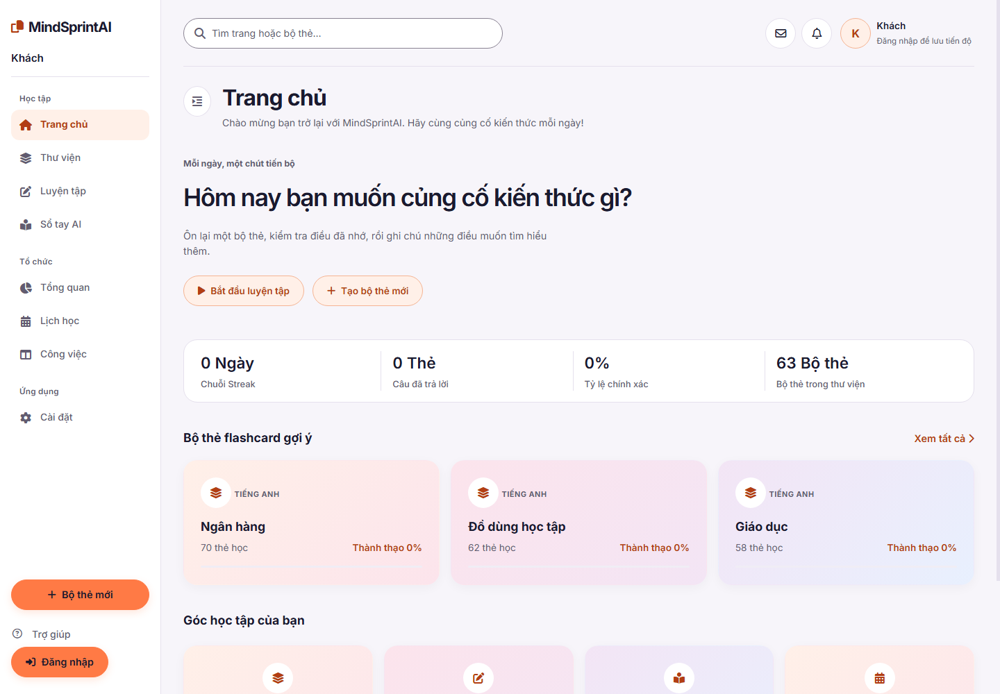
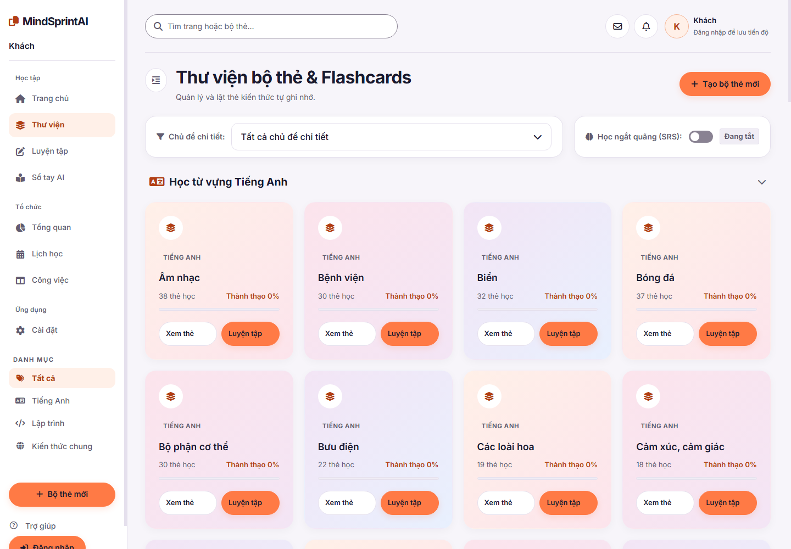
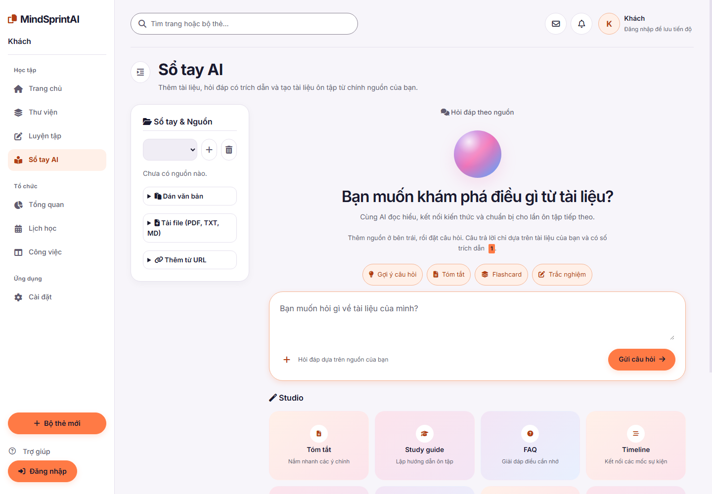
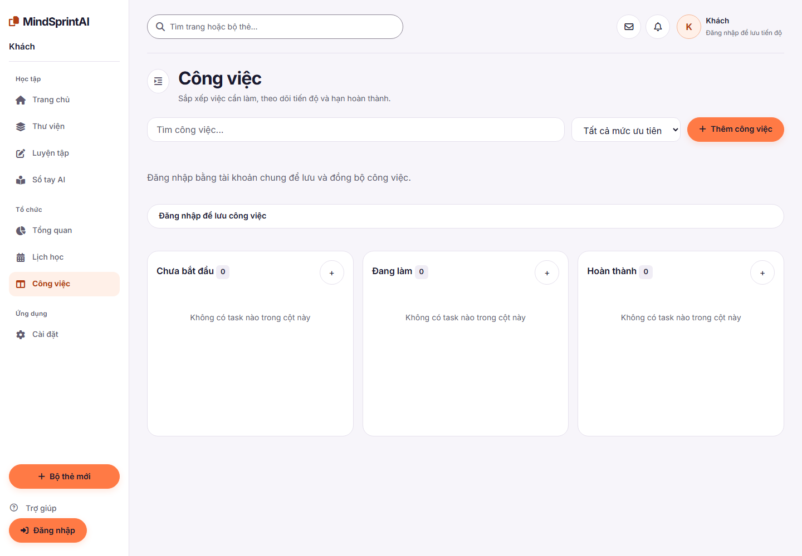

# 🧠 MindSprintAI

[](https://github.com/tungtungsahul/MindSprint-AI-D-n/actions)
[](https://dotnet.microsoft.com/)
[](https://www.postgresql.org/)
[](https://ai.google.dev/)
[](LICENSE)

**MindSprint AI** là ứng dụng web giáo dục giúp sinh viên và người học tự chủ ôn tập hiệu quả hơn. Ứng dụng kết hợp **Flashcards thông minh** (Spaced Repetition), **Sổ tay AI**, **Gia sư AI** và **Kanban quản lý công việc** — tất cả trong một nền tảng duy nhất, hỗ trợ cả online và offline.

---

## ✨ Tính năng chính

| Tính năng | Mô tả |
|-----------|-------|
| 📇 **Flashcards & SRS** | Thư viện 1.814 từ Oxford seed sẵn · CRUD thẻ cá nhân · Thuật toán Spaced Repetition tự tính lịch ôn |
| 📓 **Sổ tay AI** | Lưu nguồn văn bản, URL, ảnh/PDF gốc · Hỏi đáp có trích dẫn · Tạo nội dung học tập · Mở rộng khung chat |
| 🤖 **Gia sư AI** | Giải bài, kiểm tra bài làm và gợi ý theo mức · Dùng chung nguồn ảnh/PDF trong sổ tay |
| 📋 **Kanban Board** | Quản lý công việc kéo thả 3 cột · Lọc ưu tiên · Tìm kiếm · Hạn hoàn thành |
| 📊 **Thống kê học tập** | Dashboard theo dõi tiến trình ôn tập và hoạt động |
| 🔐 **Xác thực** | Email/mật khẩu + Google Sign-In · JWT + Refresh Token · Liên kết tài khoản |
| 📱 **PWA** | Service Worker + Manifest · Cài như app trên mobile · Chạy offline bằng localStorage |

Xem [hướng dẫn nguồn ảnh/PDF](backend/TutorChecks/OCR.md) để biết giới hạn tệp và cách sử dụng.

---

## 📸 Screenshots

<!-- Thay bằng ảnh thật của dự án. Ảnh có sẵn trong frontend/design-reference/ -->

| Trang chủ | Flashcards | Sổ tay AI | Kanban |
|-----------|------------|-----------|--------|
|  |  |  |  |

---

## 🛠️ Tech Stack

| Lớp | Công nghệ |
|-----|-----------|
| **Frontend** | HTML / CSS / JavaScript (Fetch API) |
| **Backend** | C# ASP.NET Core 8 Web API |
| **Database** | PostgreSQL (EF Core Code First) |
| **Auth** | JWT + Refresh Token + Google Identity Services |
| **AI** | Google Gemini API (`gemini-3.8-flash`) |
| **CI/CD** | GitHub Actions |
| **Deploy** | Docker trên Render (API) · Vercel (Frontend) |

---

## 📋 Yêu cầu hệ thống

| Công cụ | Phiên bản |
|---------|-----------|
| [.NET SDK](https://dotnet.microsoft.com/download) | 8.0 trở lên |
| [PostgreSQL](https://www.postgresql.org/download/) | 14 trở lên |
| [Node.js](https://nodejs.org/) *(chỉ cần cho build Vercel)* | 20 trở lên |
| [Git](https://git-scm.com/) | Bất kỳ |

---

## 🚀 Cài đặt & Chạy

### 1. Clone dự án

```bash
git clone https://github.com/tungtungsahul/MindSprint-AI-D-n.git
cd MindSprint-AI-D-n
```

### 2. Cài đặt Database

```sql
-- Kết nối PostgreSQL và tạo database:
CREATE DATABASE mindsprint;
```

> Backend sẽ **tự chạy EF Core Migrations** và **seed 1.814 từ Oxford** khi khởi động lần đầu.

### 3. Cấu hình biến môi trường

Sửa `backend/MindSprint.Api/appsettings.json` hoặc dùng biến môi trường:

| Biến | Bắt buộc | Mặc định | Mô tả |
|------|:--------:|----------|-------|
| `ConnectionStrings__Default` | ✅ | `Host=localhost;Database=mindsprint;...` | Chuỗi kết nối PostgreSQL |
| `Jwt__Key` | ✅ | *(placeholder)* | Khóa bí mật JWT, ≥ 32 ký tự |
| `Gemini__ApiKey` | ✅ | — | API key từ [Google AI Studio](https://aistudio.google.com/apikey) |
| `Cors__Origins` | ✅ | — | Origin của frontend, vd: `http://127.0.0.1:5500` |
| `Google__ClientId` | ❌ | — | OAuth Client ID cho Google Sign-In |

> ⚠️ **Không commit khóa bí mật.** Dùng biến môi trường (vd: `Gemini__ApiKey`) hoặc User Secrets.

### 4. Chạy backend

```bash
cd backend/MindSprint.Api
dotnet run          # Tự Migrate + Seed, Swagger tại /swagger
```
Sửa cấu hình cục bộ: chuỗi kết nối PostgreSQL, `Jwt:Key` (>= 32 ký tự), `Gemini:ApiKey`, `Cors:Origins`. Giữ khóa API ngoài commit; có thể dùng biến môi trường `Gemini__ApiKey`.

Để bật tạo flashcard AI khi chạy local, dùng .NET User Secrets (không đặt key trong frontend hoặc commit vào Git):
```powershell
dotnet user-secrets set "Gemini:ApiKey" "<YOUR_GEMINI_API_KEY>" --project backend/MindSprint.Api
```
Sau khi cấu hình, khởi động lại backend để nạp key. Thay `<YOUR_GEMINI_API_KEY>` bằng key tạo tại Google AI Studio; tránh lưu key thật trong lịch sử terminal. `.env` không được ASP.NET Core nạp mặc định.
Khi chạy local, `frontend/api.js` tự dùng `http://localhost:5000`; khi triển khai Vercel, biến `API_BASE` được nhúng lúc build. Xem [hướng dẫn triển khai](CI-CD-SETUP.md).

Backend chạy tại `http://localhost:5000` (HTTP) và `https://localhost:5100` (HTTPS).

### 5. Chạy frontend

**Cách 1** — VS Code Live Server (khuyên dùng):
> Mở thư mục `frontend/` bằng Live Server ở cổng 5500 (đã có sẵn trong CORS).

**Cách 2** — Python HTTP Server:
```bash
# Từ thư mục gốc dự án, mở terminal thứ hai:
python -m http.server 5500 --bind 127.0.0.1
```

Mở trình duyệt tại **`http://127.0.0.1:5500/frontend/`**.

> Khi chạy local, `frontend/api.js` tự dùng `http://localhost:5000`. Khi triển khai Vercel, biến `API_BASE` được nhúng lúc build.

---

## 🔑 Đăng nhập Google

Hộp đăng nhập/đăng ký hỗ trợ **Google Identity Services**, dùng chung JWT và refresh session với đăng nhập email.

1. Đặt `Google__ClientId` và cấu hình Authorized JavaScript origins trong Google Cloud Console.
2. Xem chi tiết tại [hướng dẫn cấu hình Google](backend/GOOGLE_SIGN_IN.md).
3. Email đã có tài khoản cần nhập mật khẩu MindSprintAI hiện tại trước khi liên kết, để giữ nguyên dữ liệu học tập.

> Khi chưa cấu hình Google, đăng nhập bằng email và tài khoản Demo vẫn hoạt động bình thường.

---

## 📋 Kanban tích hợp

Tab **Công việc** dùng chung hệ thống auth (`MindSprintAuth`) và API (`MindSprintApi`) với Sổ tay AI, thư viện và lịch học:

- ➕ Thêm / ✏️ Sửa / 🗑️ Xóa công việc
- 🖱️ Kéo thả hoặc nút chuyển cột
- 🔍 Tìm kiếm, lọc ưu tiên và hạn hoàn thành
- 💾 Lưu vào PostgreSQL theo tài khoản; khi lỗi kết nối, form giữ nguyên để thử lại
- 📌 Thả ở nửa trên/dưới thẻ để chọn vị trí chèn; vạch màu đánh dấu vị trí đích

---

## 📁 Cấu trúc dự án

```
MindSprint-AI-D-n/
├── frontend/                          # Giao diện (HTML/CSS/JS thuần)
│   ├── index.html                     # Trang chính
│   ├── style.css                      # CSS chính
│   ├── tokens.css                     # Design tokens
│   ├── script.js                      # Logic chính
│   ├── api.js                         # Client gọi API backend
│   ├── auth.js                        # Xử lý đăng nhập/đăng ký
│   ├── notebook.js                    # Module Sổ tay AI
│   ├── kanban.js                      # Module Kanban
│   ├── sw.js                          # Service Worker (PWA)
│   └── design-reference/             # Mockup & ảnh tham chiếu
│
├── backend/
│   ├── MindSprint.Api/                # ASP.NET Core Web API
│   │   ├── Controllers/
│   │   │   ├── AuthController.cs          # Đăng nhập/đăng ký email
│   │   │   ├── GoogleAuthController.cs    # Đăng nhập Google
│   │   │   ├── FlashcardsController.cs    # CRUD flashcards
│   │   │   ├── ReviewController.cs        # SRS review
│   │   │   ├── TasksController.cs         # Kanban CRUD + move
│   │   │   ├── AiController.cs            # Gemini AI endpoint
│   │   │   ├── NotebooksController.cs     # Sổ tay AI
│   │   │   ├── StudyStatsController.cs    # Thống kê học tập
│   │   │   └── TutorController.cs         # Gia sư AI
│   │   ├── Models/Entities.cs         # User, Flashcard, CardProgress, KanbanTask
│   │   ├── Data/
│   │   │   ├── AppDbContext.cs        # EF Core DbContext
│   │   │   ├── DataSeeder.cs          # Seed 1.814 từ Oxford
│   │   │   └── vocab_seed.json        # Dữ liệu seed
│   │   ├── Services/
│   │   │   ├── SpacedRepetitionService.cs   # Thuật toán SRS
│   │   │   ├── GeminiService.cs             # Gọi Gemini API
│   │   │   ├── TokenService.cs              # JWT token
│   │   │   ├── TutorService.cs              # Logic gia sư AI
│   │   │   └── NotebookAi.cs               # AI cho sổ tay
│   │   └── Migrations/               # EF Core migrations
│   │
│   ├── GoogleAuthChecks/              # Test – Google Auth
│   ├── KanbanChecks/                  # Test – Kanban
│   ├── TutorChecks/                   # Test – Tutor AI
│   └── UrlImportChecks/              # Test – URL import
│
└── docs/
    ├── architecture/                  # Tài liệu kiến trúc
    │   ├── software-architecture.md   # Kiến trúc phần mềm
    │   ├── non-functional-requirements.md  # 14 NFR
    │   ├── erd.md                     # ERD (10 bảng, 69 cột)
    │   └── sprint-4-test-plan.md      # Kế hoạch kiểm thử
    └── decisions/                     # Architecture Decision Records
        ├── 0001-layered-monolith.md
        ├── 0002-postgresql-and-deployment.md
        ├── 0003-identity-and-account-isolation.md
        └── 0004-ai-and-source-boundaries.md
```

---

## 🧪 Chạy test

Dự án có 4 test project riêng:

```bash
# Google Auth checks
dotnet run --project backend/GoogleAuthChecks

# Kanban checks
dotnet run --project backend/KanbanChecks

# Tutor AI checks
dotnet run --project backend/TutorChecks

# URL Import checks
dotnet run --project backend/UrlImportChecks
```

Frontend test (Node.js):
```bash
cd backend/TutorChecks
node browser.test.cjs
node frontend-tutor.test.cjs
```

---

## 🌐 Triển khai

| Thành phần | Nền tảng | Ghi chú |
|------------|----------|---------|
| **API** | [Render](https://render.com) | Docker · PostgreSQL managed · Auto migration |
| **Frontend** | [Vercel](https://vercel.com) | Git integration · Biến `API_BASE` nhúng lúc build |

Xem hướng dẫn chi tiết tại [CI-CD-SETUP.md](CI-CD-SETUP.md).

---

## 📐 Kiến trúc và yêu cầu phi chức năng

[Bộ tài liệu kiến trúc](docs/architecture/README.md) bao gồm:

| Tài liệu | Nội dung |
|-----------|----------|
| [Kiến trúc phần mềm](docs/architecture/software-architecture.md) | Bối cảnh, thành phần, dữ liệu, luồng xử lý, triển khai |
| [ERD](docs/architecture/erd.md) | 10 bảng, 69 cột, khóa ngoại và quan hệ nghiệp vụ |
| [Yêu cầu phi chức năng](docs/architecture/non-functional-requirements.md) | 14 NFR có tiêu chí đo được |
| [Kế hoạch kiểm thử Sprint 4](docs/architecture/sprint-4-test-plan.md) | Issues #42–#55, thứ tự và điều kiện nghiệm thu |
| [ADR-001](docs/decisions/0001-layered-monolith.md) | Backend theo tầng trong một ứng dụng |
| [ADR-002](docs/decisions/0002-postgresql-and-deployment.md) | PostgreSQL và triển khai frontend/API riêng |
| [ADR-003](docs/decisions/0003-identity-and-account-isolation.md) | JWT, refresh token và ranh giới tài khoản |
| [ADR-004](docs/decisions/0004-ai-and-source-boundaries.md) | Cô lập Gemini và nguồn tài liệu ngoài |

> Các ngưỡng NFR là mục tiêu đề xuất; chưa có kết quả nghiệm thu.

---

## 🤝 Đóng góp

1. Fork repository
2. Tạo branch tính năng (`git checkout -b feature/ten-tinh-nang`)
3. Commit thay đổi (`git commit -m "Thêm tính năng XYZ"`)
4. Push lên branch (`git push origin feature/ten-tinh-nang`)
5. Tạo Pull Request vào `main`

---

## 📄 License

Dự án được phân phối theo giấy phép [MIT](LICENSE).
