# ERD — MindSprintAI

**Ngày:** 26/10/2026. **Baseline:** `1a9fecb807e7232a898a27c826615aac657fd798`. **Nguồn:** PostgreSQL model snapshot và migrations trên `main`, gồm `AddNotebookGenerationCache`, `AddNotebookSourceFiles` và `AddWeakArea`. ERD mô tả schema trong mã nguồn; chưa đối chiếu database đang chạy. Bản FastAPI/SQLite độc lập không thuộc sơ đồ này.

**Mermaid source:** [erd.mmd](erd.mmd). GitHub hiển thị sơ đồ đầy đủ bên dưới. [SVG](erd.svg) và [PNG](erd.png) được xuất lại từ cùng nguồn bằng Mermaid 11.4.1; xem [log kiểm tra](../testing/evidence/sprint-3/diagrams.txt).

## Quy ước

- PK: khóa chính; FK: khóa ngoại đã khai báo trong migration; UK/UQ: unique index.
- REF: tham chiếu theo nghiệp vụ nhưng **chưa có ràng buộc FK** trong database.
- ?: nullable; UQ* là unique index theo tổ hợp cột, không có nghĩa từng cột duy nhất riêng.
- 1: đúng một; 0..1: tối đa một; 0..N: không hoặc nhiều.
- Trong sơ đồ này, nét liền đánh dấu quan hệ có FK thực; nét đứt đánh dấu tham chiếu nghiệp vụ chưa có FK. Đây là quy ước chú thích riêng của sơ đồ, không suy diễn tính identifying từ nét vẽ.

## 7 khóa ngoại thực

| Quan hệ | Số lượng | Khi xóa bản ghi cha |
| --- | --- | --- |
| Notebooks.Id → NotebookNotes.NotebookId | 1 → 0..N | CASCADE |
| Notebooks.Id → NotebookSources.NotebookId | 1 → 0..N | CASCADE |
| Users.Id → Flashcards.OwnerId | 0..1 → 0..N | CASCADE |
| Users.Id → RefreshTokens.UserId | 1 → 0..N | CASCADE |
| Flashcards.Id → CardProgresses.FlashcardId | 1 → 0..N | CASCADE |
| Notebooks.Id → NotebookGenerationCaches.NotebookId | 1 → 0..N | CASCADE |
| Users.Id → WeakAreas.UserId | 1 → 0..N | CASCADE |

Mọi bảng dùng Id kiểu integer làm PK, với IdentityByDefaultColumn theo migration. Flashcards.OwnerId cho phép NULL: thẻ hệ thống không thuộc tài khoản riêng. Quan hệ Users–Flashcards vì vậy là 0..1 ở phía user của mỗi thẻ.

## 5 tham chiếu nghiệp vụ chưa có FK

| Tham chiếu | Ý nghĩa |
| --- | --- |
| CardProgresses.UserId → Users.Id | Tiến trình ôn tập của người học |
| Tasks.UserId → Users.Id | Công việc của tài khoản |
| Notebooks.UserId → Users.Id | Chủ sở hữu sổ tay |
| UserStudyDays.UserId → Users.Id | Thống kê học theo ngày |
| StudySchedules.UserId → Users.Id | Lịch học của tài khoản |

`WeakAreas.UserId` là FK thực, khác với các tham chiếu nghiệp vụ ở trên.

Các quan hệ trên là 1 → 0..N theo nghiệp vụ; database hiện chưa bảo đảm bản ghi user tồn tại hoặc cascade khi xóa user. Không đánh dấu các cột này là FK trong phần thuộc tính Mermaid.

CardProgresses là bảng kết hợp Users–Flashcards về mặt nghiệp vụ: một người học nhiều thẻ và một thẻ có nhiều người học. Unique(UserId, FlashcardId) ngăn hai hàng progress của cùng người/thẻ.

## Unique indexes

| Bảng | Cột/tổ hợp | Ghi chú |
| --- | --- | --- |
| Users | Email | Unique index |
| Users | GoogleSubject | Chỉ áp dụng khi GoogleSubject khác NULL |
| UserStudyDays | UserId, StudyDate | Unique index |
| Flashcards | ExternalId | Unique index |
| RefreshTokens | Token | Unique index |
| CardProgresses | UserId, FlashcardId | Unique index |
| NotebookGenerationCaches | NotebookId, Type, RequestHash, SourcesHash | Unique index |
| WeakAreas | UserId, Category, Topic | Unique index |

Indexes thường (không unique): Flashcards.OwnerId, CardProgresses.FlashcardId, RefreshTokens.UserId, Notebooks.UserId, NotebookSources.NotebookId, NotebookNotes.NotebookId, Tasks(UserId, Status, Position), StudySchedules(UserId, DayOfWeek), WeakAreas(UserId, AnalyzedAt). `NotebookGenerationCaches` dùng unique index theo notebook/loại/request hash/sources hash để tránh bản ghi cache trùng.

Tasks.Status lưu integer: 0=Todo, 1=Doing, 2=Done. StudySchedules.DayOfWeek: 0=Chủ nhật…6=Thứ bảy. Trong ERD, timestamptz là timestamp with time zone và time là time without time zone. Tên bảng là tên vật lý từ EF Core, ví dụ Tasks (entity KanbanTask).

## Sơ đồ Mermaid đầy đủ thuộc tính

```mermaid
erDiagram
    Notebooks ||--o{ NotebookNotes : "NotebookId - FK CASCADE"
    Notebooks ||--o{ NotebookSources : "NotebookId - FK CASCADE"
    Notebooks ||--o{ NotebookGenerationCaches : "NotebookId - FK CASCADE"
    Users |o--o{ Flashcards : "OwnerId - FK CASCADE"
    Users ||--o{ RefreshTokens : "UserId - FK CASCADE"
    Users ||--o{ WeakAreas : "UserId - FK CASCADE"
    Flashcards ||--o{ CardProgresses : "FlashcardId - FK CASCADE"
    Users ||..o{ CardProgresses : "UserId - logical ref"
    Users ||..o{ Tasks : "UserId - logical ref"
    Users ||..o{ Notebooks : "UserId - logical ref"
    Users ||..o{ UserStudyDays : "UserId - logical ref"
    Users ||..o{ StudySchedules : "UserId - logical ref"

    Users {
        int Id PK
        text Email UK
        text DisplayName
        text PasswordHash
        varchar255 GoogleSubject UK "NULL"
        timestamptz CreatedAt
    }
    RefreshTokens {
        int Id PK
        int UserId FK
        text Token UK
        timestamptz ExpiresAt
        bool IsRevoked
        text DeviceHint "NULL"
        timestamptz CreatedAt
    }
    NotebookGenerationCaches {
        int Id PK
        int NotebookId FK "Composite unique"
        varchar32 Type "Composite unique"
        varchar64 RequestHash "Composite unique"
        varchar64 SourcesHash "Composite unique"
        bool IsJson
        text ContentJson
        timestamptz CreatedAt
    }
    Flashcards {
        int Id PK
        text ExternalId UK
        text Category
        text SubCategory "NULL"
        text Question
        text Answer
        text Example "NULL"
        int OwnerId FK "NULL"
        timestamptz UpdatedAt
        int Version
    }
    CardProgresses {
        int Id PK
        int UserId "Logical ref to Users - no DB FK; Composite unique"
        int FlashcardId FK "Composite unique"
        int Repetition
        int IntervalDays
        float8 EFactor
        timestamptz NextReviewDate "NULL"
        text Status
    }
    Tasks {
        int Id PK
        int UserId "Logical ref to Users - no DB FK"
        text Title
        text Description "NULL"
        text Priority
        int Status
        int Position
        timestamptz DueDate "NULL"
        timestamptz CreatedAt
    }
    Notebooks {
        int Id PK
        int UserId "Logical ref to Users - no DB FK"
        text Title
        timestamptz CreatedAt
    }
    UserStudyDays {
        int Id PK
        int UserId "Logical ref to Users - no DB FK; Composite unique"
        date StudyDate "Composite unique"
        int CardsReviewed
        int MinutesStudied
        timestamptz LastUpdatedUtc
    }
    StudySchedules {
        int Id PK
        int UserId "Logical ref to Users - no DB FK"
        int DayOfWeek
        time StartTime
        int DurationMinutes
        text Label
        bool IsActive
    }
    WeakAreas {
        int Id PK
        int UserId FK "Composite unique"
        text Category "Composite unique"
        text SubCategory "NULL"
        text Topic "Composite unique"
        text Reason
        int WrongCount
        int TotalAttempts
        float8 AccuracyRate
        text SuggestedAction
        timestamptz AnalyzedAt "UserId index"
        timestamptz LastUpdatedAt "NULL"
    }
    NotebookSources {
        int Id PK
        int NotebookId FK
        text Title
        text Type
        text Origin "NULL"
        text Content
        bytea FileBytes "NULL"
        text FileMediaType "NULL"
        timestamptz CreatedAt
    }
    NotebookNotes {
        int Id PK
        int NotebookId FK
        text Title
        text Content
        timestamptz CreatedAt
    }
```

Tổng cộng **12 bảng, 91 cột** trong model PostgreSQL hiện tại. `NotebookSources.FileBytes` lưu file gốc (bytea, nullable); `FileMediaType` cũng nullable. `NotebookGenerationCaches` lưu kết quả sinh nội dung/trao đổi AI theo notebook và hash nguồn/yêu cầu; xóa notebook sẽ cascade cache. `WeakAreas` lưu phân tích cá nhân theo người dùng; xóa user sẽ cascade các điểm yếu. Chưa kiểm tra schema của database đang chạy.

## Nguồn kiểm chứng

- [Entities.cs](https://github.com/tungtungsahul/MindSprint-AI-D-n/blob/main/backend/MindSprint.Api/Models/Entities.cs)
- [AppDbContext.cs](https://github.com/tungtungsahul/MindSprint-AI-D-n/blob/main/backend/MindSprint.Api/Data/AppDbContext.cs)
- [Migration PostgreSQL ban đầu](https://github.com/tungtungsahul/MindSprint-AI-D-n/blob/main/backend/MindSprint.Api/Migrations/20261006104859_InitialCreate_PostgreSQL.cs)
- [Migration cache tạo nội dung](https://github.com/tungtungsahul/MindSprint-AI-D-n/blob/main/backend/MindSprint.Api/Migrations/20261012120000_AddNotebookGenerationCache.cs)
- [Migration file nguồn notebook](https://github.com/tungtungsahul/MindSprint-AI-D-n/blob/main/backend/MindSprint.Api/Migrations/20261014013142_AddNotebookSourceFiles.cs)
- [Migration điểm yếu](https://github.com/tungtungsahul/MindSprint-AI-D-n/blob/main/backend/MindSprint.Api/Migrations/20261014120000_AddWeakArea.cs)
