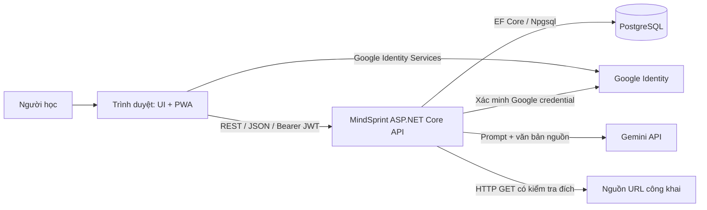
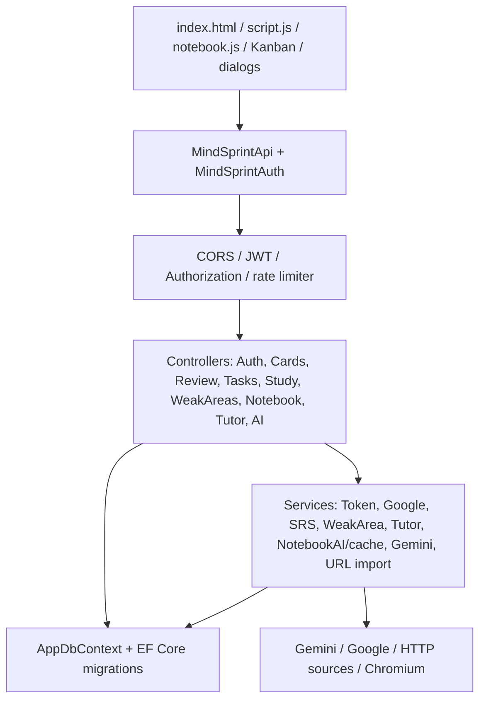
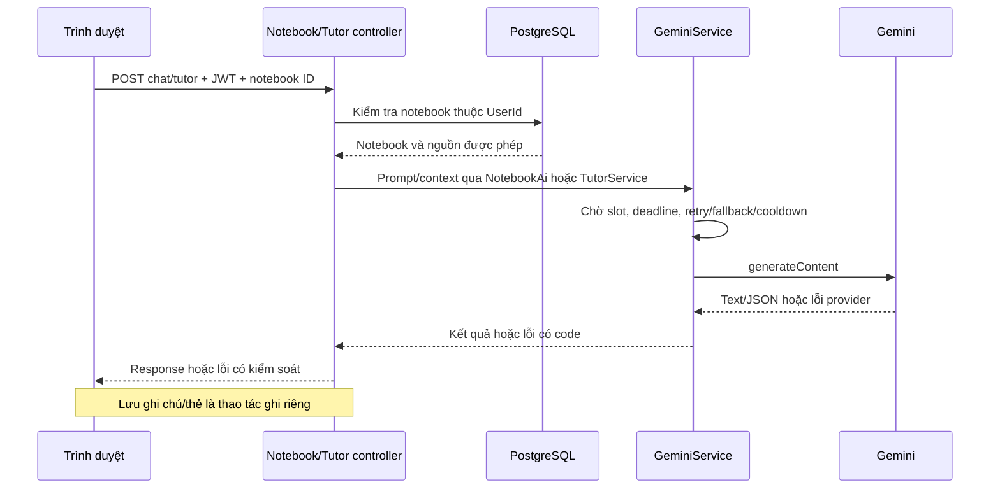
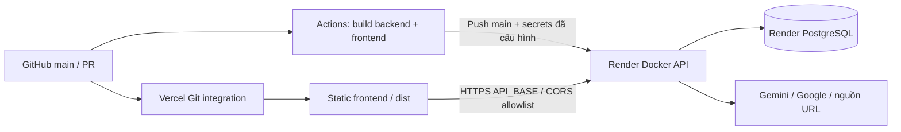

# Kiến trúc phần mềm MindSprintAI

Ngày cập nhật: **16/10/2026**. Mốc kiến trúc nền: [main / 9ba7acd](https://github.com/tungtungsahul/MindSprint-AI-D-n/tree/9ba7acd2de05bf017ad5c2711644c9ee98bd6542); mô hình dữ liệu được cập nhật theo các migration PostgreSQL hiện có trên main sau mốc này. Liên quan [#40](https://github.com/tungtungsahul/MindSprint-AI-D-n/issues/40).

## 1. Bối cảnh và phạm vi

MindSprintAI hỗ trợ học bằng flashcard và spaced repetition, sổ tay tài liệu/hỏi đáp AI, gia sư, lịch học/thống kê và bảng Kanban. Người dùng có chế độ học cục bộ và tài khoản để sử dụng dữ liệu server. Mục tiêu kiến trúc là tổ chức các chức năng trong một API dễ phát triển, kiểm soát dữ liệu theo tài khoản, bảo vệ ranh giới AI/nguồn ngoài và giữ một phần trải nghiệm khi mất mạng.

Bản chính trên main dùng ASP.NET Core 8, PostgreSQL/Npgsql và EF Core Code First. Thư mục `backend/app` + `frontend/standalone.html` là bản FastAPI với SQLite mặc định, chạy độc lập qua `run_server.py` ở cổng 8000. Hai bản không chia sẻ database/token và không phải hai microservice hợp tác.

Checkout `c5e1400` trong workspace còn dùng SQL Server, CORS mở và listener localhost 5000/5100. Những mô tả production ở đây lấy từ main, không khẳng định checkout cũ đã có các thay đổi đó.

## 2. Sơ đồ bối cảnh

Trình duyệt không truy cập DB hoặc giữ Gemini API key. Nội dung tài liệu/câu hỏi đưa vào prompt đi qua backend tới Gemini; đó là ranh giới dữ liệu cần công khai cho người dùng. Google không thay thế cơ chế phân quyền nội bộ của MindSprint.

## 3. Kiến trúc logic và thành phần

Kiểu kiến trúc: **client–server, backend theo tầng trong một ứng dụng (layered monolith)**. Đây không phải Clean Architecture với domain độc lập: nhiều controller truy cập trực tiếp AppDbContext; services chứa các xử lý cần tái sử dụng.

| Nhóm | Trách nhiệm | Điểm mã nguồn |
| --- | --- | --- |
| Giao diện chính | Điều hướng, học tập, sổ tay, bảng công việc và thông báo lỗi | [frontend](https://github.com/tungtungsahul/MindSprint-AI-D-n/blob/9ba7acd2de05bf017ad5c2711644c9ee98bd6542/frontend/index.html), [script.js](https://github.com/tungtungsahul/MindSprint-AI-D-n/blob/9ba7acd2de05bf017ad5c2711644c9ee98bd6542/frontend/script.js), [notebook.js](https://github.com/tungtungsahul/MindSprint-AI-D-n/blob/9ba7acd2de05bf017ad5c2711644c9ee98bd6542/frontend/notebook.js) |
| API/phiên phía client | Bearer token, refresh single-flight trong tab, loại response từ phiên cũ | [api.js](https://github.com/tungtungsahul/MindSprint-AI-D-n/blob/9ba7acd2de05bf017ad5c2711644c9ee98bd6542/frontend/api.js), [auth.js](https://github.com/tungtungsahul/MindSprint-AI-D-n/blob/9ba7acd2de05bf017ad5c2711644c9ee98bd6542/frontend/auth.js) |
| API HTTP | DTO/validation, authorization, chuyển kết quả/lỗi sang HTTP; API điểm yếu cá nhân | [Controllers](https://github.com/tungtungsahul/MindSprint-AI-D-n/tree/main/backend/MindSprint.Api/Controllers) |
| Học và AI | SRS, phân tích điểm yếu, context từ nguồn, cache sinh nội dung, gia sư/check/hints, gọi Gemini | [Services](https://github.com/tungtungsahul/MindSprint-AI-D-n/tree/main/backend/MindSprint.Api/Services) |
| Nguồn ngoài | Kiểm tra URL/DNS/socket/redirect, đọc tài liệu, renderer JS hạn chế tài nguyên | [URL_IMPORT.md](https://github.com/tungtungsahul/MindSprint-AI-D-n/blob/9ba7acd2de05bf017ad5c2711644c9ee98bd6542/backend/URL_IMPORT.md) |
| Dữ liệu | Entity, truy vấn, index, migration và seed | [AppDbContext](https://github.com/tungtungsahul/MindSprint-AI-D-n/blob/9ba7acd2de05bf017ad5c2711644c9ee98bd6542/backend/MindSprint.Api/Data/AppDbContext.cs), [Entities](https://github.com/tungtungsahul/MindSprint-AI-D-n/blob/9ba7acd2de05bf017ad5c2711644c9ee98bd6542/backend/MindSprint.Api/Models/Entities.cs) |
| Vận hành | DI, JWT/CORS, provider, startup migration, health endpoint | [Program.cs](https://github.com/tungtungsahul/MindSprint-AI-D-n/blob/9ba7acd2de05bf017ad5c2711644c9ee98bd6542/backend/MindSprint.Api/Program.cs) |

Không bổ sung message broker, Redis hay vector DB trong kiến trúc hiện tại. Chỉ cân nhắc khi số đo thực tế cho thấy cần thiết.

## 4. Mô hình dữ liệu và ranh giới tài khoản

Xem [ERD đầy đủ](erd.md) với 12 bảng, 91 cột và cardinality; model có cache tạo nội dung gắn với notebook, file nguồn tùy chọn và dữ liệu điểm yếu gắn với user. Quan hệ cascade/index được đối chiếu theo migration, không suy ra chỉ từ navigation property. [Mermaid source](erd.mmd) là bản hiện hành; ảnh PNG/SVG cũ chưa được tái sinh. Sơ đồ phân biệt 7 FK thực với 5 tham chiếu nghiệp vụ chưa có FK.

| Dữ liệu | Quy tắc và lưu ý |
| --- | --- |
| User / RefreshToken | Email unique; GoogleSubject unique khi khác null; refresh token gắn tài khoản, có hết hạn/thu hồi |
| Flashcard / CardProgress | OwnerId=null là thẻ hệ thống; thẻ riêng lọc theo owner; progress unique theo UserId + FlashcardId |
| KanbanTask | UserId, Status, Position; index theo ba trường; thứ tự phải được kiểm tra khi cập nhật đồng thời |
| Notebook / Source / Note / GenerationCache | Notebook thuộc user; nguồn, ghi chú và cache thuộc notebook; xóa notebook cascade các hàng liên quan. Nguồn có thể lưu byte file và media type nullable |
| UserStudyDay / StudySchedule | Ngày học unique theo UserId + StudyDate; lịch theo user/ngày tuần; xử lý ngày học UTC+7 |
| WeakArea | Phân tích điểm yếu theo user/category/topic; unique theo bộ ba và cascade khi xóa user |

Đây là quan hệ nghiệp vụ; không giả định mọi trường UserId đều có foreign key nếu AppDbContext không cấu hình. PostgreSQL là nguồn dữ liệu server. localStorage chứa token, cài đặt, dữ liệu học cục bộ và queue hỗ trợ offline; backup DB không khôi phục các thao tác chưa sync.

Flashcard có Version/UpdatedAt và có thể trả 409 khi client gửi phiên bản cũ. Version hiện optional và chưa là EF concurrency token: hai request cùng đọc Version có thể cùng ghi. Một SaveChanges có tính nguyên tử cho các thay đổi trong lần lưu, không tự bảo vệ toàn bộ chuỗi đọc→sửa giữa nhiều request. [EF Core mô tả concurrency token](https://learn.microsoft.com/en-us/ef/core/saving/concurrency); Sprint 4 phải kiểm chứng race bằng PostgreSQL thật.

## 5. Các luồng quan trọng

### Đăng nhập và làm mới phiên

1. UI gửi email/password hoặc Google credential + nonce tới API.
2. Backend kiểm tra mật khẩu qua PasswordHasher hoặc credential/nonce Google. Liên kết email đã tồn tại yêu cầu mật khẩu hiện tại.
3. API cấp access JWT (mặc định 15 phút) và refresh token (7 ngày), frontend lưu localStorage.
4. API dữ liệu xác minh JWT, lấy UserId từ claim và lọc tài nguyên theo chủ sở hữu.
5. Khi 401, client dùng refresh để xoay token rồi thử lại một lần. Đăng xuất xóa state phía client và cố thu hồi refresh token.
6. JWT đã cấp không có danh sách thu hồi tức thời; có thể còn hiệu lực đến hết hạn cộng ClockSkew. Thu hồi refresh không đồng nghĩa thu hồi mọi access JWT.

Token trong localStorage làm XSS trở thành rủi ro trực tiếp. Single-flight phía client không giải quyết race refresh giữa nhiều tab/request server. Các ca này thuộc NFR-03/04/05.

### Sổ tay và AI

Context notebook cắt nội dung mỗi nguồn để tổng nội dung nguồn khoảng 300.000 ký tự; header/history/question có thể làm prompt dài hơn, đây không phải token budget chính xác. Hỏi theo nguồn yêu cầu trích dẫn và chỉ dùng nguồn; Gia sư có thể giải bằng kiến thức mô hình. Hội thoại tutor giữ trong bộ nhớ trang, chỉ ghi chú được lưu bền khi người dùng yêu cầu. Chi tiết [Tutor](https://github.com/tungtungsahul/MindSprint-AI-D-n/blob/9ba7acd2de05bf017ad5c2711644c9ee98bd6542/backend/TutorChecks/README.md) và [Sprint 2](https://github.com/tungtungsahul/MindSprint-AI-D-n/blob/9ba7acd2de05bf017ad5c2711644c9ee98bd6542/backend/TutorChecks/SPRINT2.md).

### URL/file và dữ liệu cục bộ

URL importer chỉ đọc nguồn công khai qua HTTP/HTTPS, kiểm tra mỗi redirect và socket, hạn chế dữ liệu giải nén/Office XML/renderer. Upload trực tiếp chỉ PDF có lớp chữ, TXT/MD/CSV và tối đa 10 MiB; không suy diễn mọi định dạng URL cũng upload được. Bộ đọc URL từ chối nội dung quá dài; Store nguồn text/upload vẫn cắt ở 200.000 ký tự nên cần kiểm tra phản hồi UX.

Service worker cache app/assets, bỏ qua API và Google Identity. Sau tải online thành công, một số hoạt động học cục bộ có thể dùng offline. Kanban/notebook/AI cần mạng; queue hiện có không phải một cơ chế đồng bộ mọi chức năng.

## 6. Triển khai và cấu hình

[render.yaml](https://github.com/tungtungsahul/MindSprint-AI-D-n/blob/9ba7acd2de05bf017ad5c2711644c9ee98bd6542/render.yaml) và [CI-CD-SETUP.md](https://github.com/tungtungsahul/MindSprint-AI-D-n/blob/9ba7acd2de05bf017ad5c2711644c9ee98bd6542/CI-CD-SETUP.md) mô tả cấu hình, chưa chứng minh service đã deploy thành công. Vercel build riêng với API_BASE; GitHub Actions build cả hai và trigger Render sau push main nếu có secrets. Backend đọc PORT và bind 0.0.0.0; TLS ở edge của hosting, Kestrel nội bộ HTTP. URL kết nối PostgreSQL được chuyển qua PostgresConnectionString (SSL Require cho URL).

| Cấu hình | Vai trò |
| --- | --- |
| ConnectionStrings__Default | Kết nối PostgreSQL, không đưa vào frontend/log |
| Jwt__Key / Jwt__Issuer / Jwt__Audience | Chữ ký/issuer/audience JWT; key ít nhất 32 ký tự |
| Cors__AllowedOrigins | Allowlist frontend/preview; production yêu cầu cấu hình |
| Gemini__ApiKey / Gemini__Model / Gemini__FallbackModels | Credential và model provider |
| Gemini__TotalTimeoutSeconds / AttemptTimeoutSeconds / MaxRetries / MaxConcurrentRequests | Mặc định trong code 150 s / 60 s / 2 / 2; cấu hình thực có thể ghi đè |
| Google__ClientId | OAuth client ID để bật Google Sign-In |
| API_BASE | HTTPS URL API nhúng vào runtime-config.js lúc build frontend |

main chỉ mở Swagger ở Development. Startup chạy MigrateAsync và seed; lỗi DB/migration ngăn startup. Seed bỏ demo ở Production nhưng /api/auth/demo vẫn có thể tạo user với mật khẩu cố định — chưa thể kết luận demo đã bị khóa production.

Docker hiện chưa cài Chromium; renderer dùng Edge trên Windows hoặc Playwright Chromium trên Linux. URL cần JS có thể thiếu runtime trong image; NFR-12 cần kiểm tra. Free hosting/cold start và lưu giữ database phải đối chiếu thực tế trước khi chốt SLO; tài liệu này không khẳng định một SLA của nhà cung cấp.

## 7. Đáp ứng chất lượng và khoảng trống

| Quyết định/cơ chế hiện có | NFR liên quan | Khoảng trống cần kiểm chứng |
| --- | --- | --- |
| Async API, AsNoTracking, indexes, frontend tĩnh | 01, 02 | Chưa có benchmark; GET danh sách chưa phân trang |
| JWT/refresh, user filtering, Google nonce | 03 | Race rotation và giới hạn thu hồi access JWT |
| URL guard, output renderer, validation | 04 | XSS toàn luồng, cắt nguồn âm thầm, giới hạn concurrent sources |
| CORS allowlist, env config, TLS hosting | 05 | Demo endpoint, secret/log redaction, thông báo dữ liệu gửi AI |
| Gemini timeout/retry/fallback, giới hạn slot | 02, 06 | Mỗi CallAsync có budget riêng; tutor nhiều lượt có thể lâu hơn |
| Version/index/SaveChanges | 07 | Lost update và thứ tự Kanban giữa request đồng thời |
| /healthz và cấu hình Render health check | 08 | Health hiện không kiểm tra DB; chưa có monitor nghiệm thu |
| PostgreSQL lưu dữ liệu server | 09 | Chưa có bằng chứng backup/restore và runbook |
| Responsive, validation inline, nút reorder | 10, 11 | Ma trận browser, screen reader, offline/cache update |
| CI build, Docker, migrations | 12 | CI chưa chạy harness; browser runtime image |
| Auth console log, warning provider | 13 | Correlation/metrics và loại dữ liệu nhạy cảm khỏi log |
| Prompt theo nguồn, tutor review, JSON parsing | 14 | Prompt không bảo đảm đúng; JSON parse không thay schema validation |

Ngưỡng, kịch bản và bằng chứng cho từng ID nằm ở [yêu cầu phi chức năng](non-functional-requirements.md). Kết quả kiểm thử phải liên kết về ID và commit, không đánh dấu “đạt” chỉ vì có cơ chế tương ứng trong code.

## 8. Các quyết định kiến trúc

Xem [ADR-001](../decisions/0001-layered-monolith.md), [ADR-002](../decisions/0002-postgresql-and-deployment.md), [ADR-003](../decisions/0003-identity-and-account-isolation.md) và [ADR-004](../decisions/0004-ai-and-source-boundaries.md). Các phương án thay thế được phân tích để phục vụ review; không phải lịch sử quyết định được tác giả cũ xác nhận.
