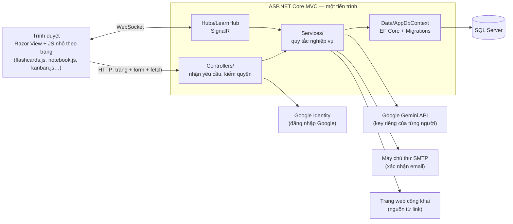
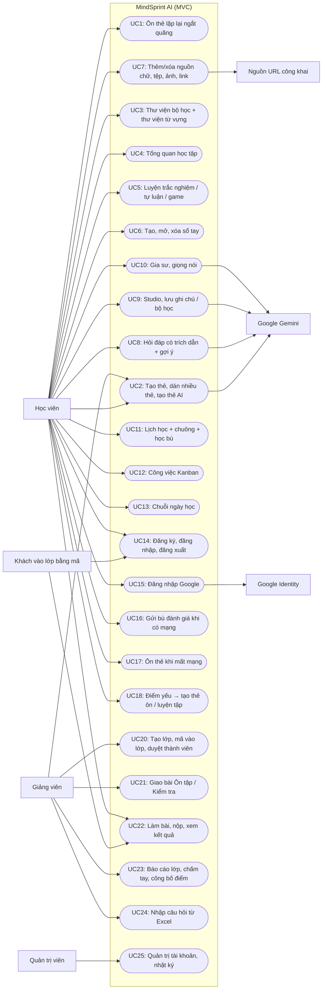
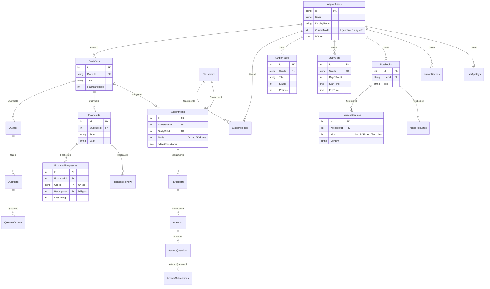
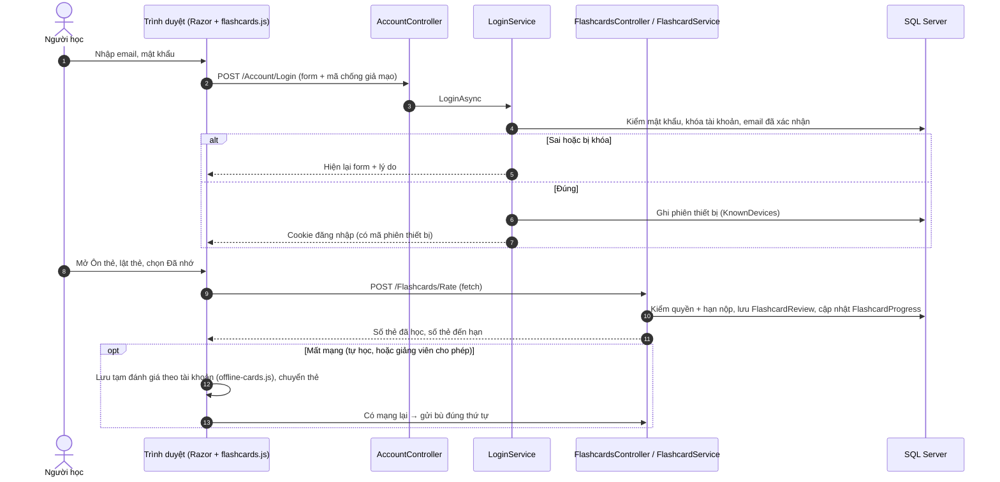
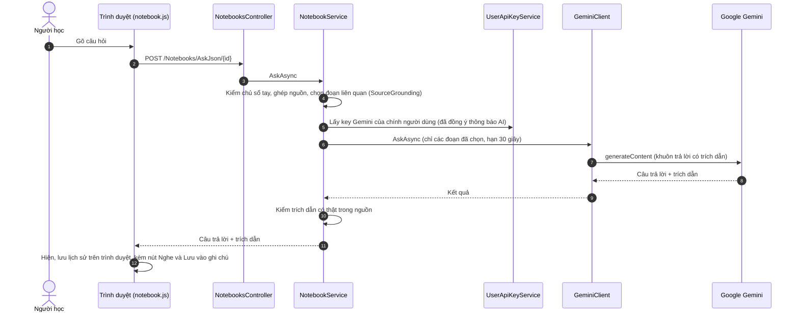
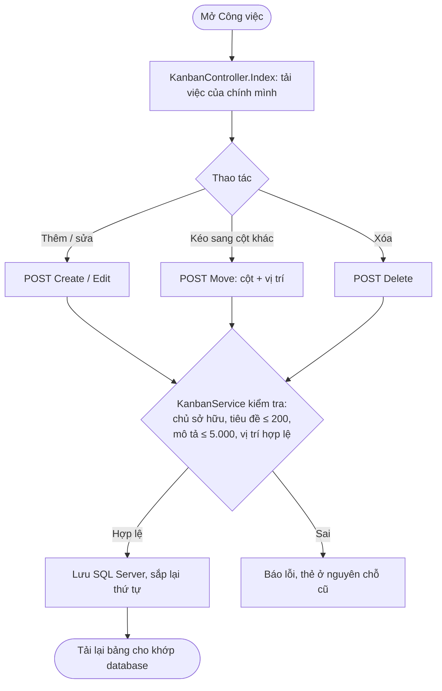
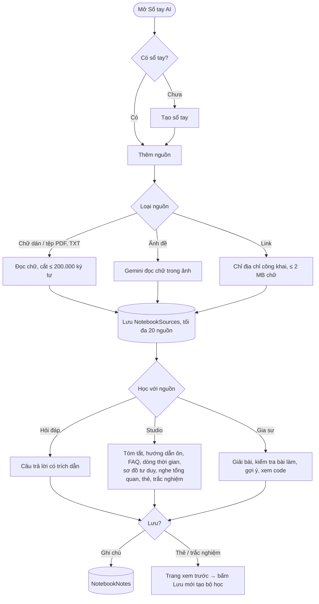

# Tài liệu kiến trúc MindSprint AI (bản ASP.NET Core MVC)

> **Dành cho nhóm môn Công nghệ phần mềm (CNPM).** Tài liệu này giúp nhóm hiểu project mới khi đọc lại các sơ đồ cũ (`MindSprint-AI-D-n/docs/architecture/`). Nó **không thay** tài liệu nộp của nhóm CNPM; nhóm tự quyết có cập nhật sơ đồ của mình hay không. Mọi tên bảng, lớp, đường dẫn dưới đây lấy từ mã nguồn project mới ngày 15/11/2026.

## 1. Thay đổi lớn nhất trong một câu

Bản cũ là **hai phần tách rời** (giao diện HTML/JS gọi API bằng JWT); bản mới là **một ứng dụng ASP.NET Core MVC**: máy chủ dựng sẵn trang (Razor), JS chỉ lo phần tương tác. Chức năng và giao diện giữ theo bản nhóm; khung (database, quy tắc nghiệp vụ, bảo mật) lấy từ project QuizEduManager.

| | Bản cũ (MindSprint-AI-D-n) | Bản mới (MindSprintAI_ASP.NET_MVC) |
|---|---|---|
| Kiến trúc | Frontend tĩnh (Vercel) + Web API .NET 8 (Render) | Một project ASP.NET Core MVC .NET 10 |
| Database | PostgreSQL (Render) / SQL Server, 12 bảng | SQL Server, 49 bảng + bảng tài khoản của Identity |
| Đăng nhập | JWT + refresh token | ASP.NET Identity (cookie) + phiên thiết bị, xác thực 2 bước, passkey, Google |
| Logic | Nhiều logic nằm trong `script.js` (218 KB, chạy trên trình duyệt) | Quy tắc nghiệp vụ nằm trong `Services/` (chạy trên máy chủ) |
| Thời gian thực | Không | SignalR (`Hubs/LearnHub.cs`): thông báo, theo dõi bài làm |
| Vai trò người dùng | Một loại người học | Học viên, Giảng viên, Quản trị viên, Khách vào lớp bằng mã |

## 2. Sơ đồ thành phần (mới, bản cũ không có)

Quy ước làm việc: **Database → Service → Controller → View**. View không tự chấm điểm hay kiểm quyền; mọi kiểm tra nằm ở Service.

## 3. Use case (đối chiếu với `usecase.mmd` cũ)

Giữ nguyên số UC1–UC18 của nhóm; UC19 trở đi là phần thêm từ QuizEdu.

| UC cũ | Khác gì ở bản mới |
|---|---|
| UC14 "làm mới, đăng xuất" | Không còn refresh token; phiên cookie tự gia hạn. Có thêm "Đăng xuất tất cả thiết bị" |
| UC16, UC17 | Chỉ áp cho ôn thẻ; tự học luôn được, bài lớp giao do giảng viên bật ("Cho học viên ôn thẻ tiếp khi mất mạng") |
| UC4, UC13 | Số liệu tính trên máy chủ từ hoạt động thật, trình duyệt không tự khai số thẻ / ngày học |
| UC19 (AI lập kế hoạch, mục tiêu cũ) | Chưa làm, như bản nhóm (GAP-01) |

## 4. ERD (đối chiếu với `erd.mmd` cũ)

Chỉ vẽ các bảng chính; danh sách đủ 49 bảng ở mục 4.2.

> **Khác bản cũ:** mọi khóa ngoại của các bảng học tập đặt **Restrict** (không xóa dây chuyền). Xóa sổ tay hay tài khoản thì service tự xóa con trước, trong một giao dịch. Bản cũ dùng CASCADE.

### 4.1 Bảng cũ → bảng mới

| Bảng cũ | Bảng mới | Ghi chú |
|---|---|---|
| Users | AspNetUsers (`ApplicationUser`) | Bảng của ASP.NET Identity |
| RefreshTokens | — (+ KnownDevices) | Không dùng JWT; phiên thiết bị lưu ở KnownDevices |
| Flashcards (thẻ của mỗi người, có danh mục) | StudySets + Flashcards | Thẻ thuộc một bộ học. Thẻ từ vựng hệ thống nằm trong `Data/Vocab/vocab.json`, không ở database |
| CardProgresses | FlashcardProgresses + FlashcardReviews | Thêm lịch sử từng lần đánh giá |
| Tasks | KanbanTasks | |
| Notebooks, NotebookSources, NotebookNotes | giữ tên | |
| NotebookGenerationCaches | — | Không lưu đệm kết quả AI |
| UserStudyDays | — | Tính từ FlashcardReviews + AnswerSubmissions |
| StudySchedules | StudySlots | Bỏ "bật/tắt" (giao diện cũ không dùng) |
| WeakAreas | — | Tính ngay khi mở trang Điểm yếu |

### 4.2 Đủ 49 bảng theo nhóm

- **Học liệu:** StudySets, Quizzes, Questions, QuestionOptions, QuestionBlanks, BlankAnswers, QuestionRevisions, Flashcards, FlashcardProgresses, FlashcardReviews, SourceTexts
- **Lớp và bài giao:** Classrooms, ClassMembers, JoinCodes, JoinCodeFailures, Invitations, ClassTransfers, Assignments, AssignmentChanges, Participants, Guests, RetakeRequests, UnhideRequests
- **Làm bài và chấm:** Attempts, AttemptQuestions, AnswerSubmissions, Regrades, ScoreHistories, DeviceChangeRequests, ScreenLeaves
- **Tài khoản và an toàn:** KnownDevices, AccountLocks, UserApiKeys, UserSettingPresets, AdminAccessLogs, AdminRoleChanges, AuditEntries, ContentReports
- **AI:** AiConversations, AiMessages, AiCitations, Notebooks, NotebookSources, NotebookNotes
- **Tổ chức:** KanbanTasks, StudySlots, Notifications, Reminders, ReminderDigests

## 5. Sơ đồ tuần tự: đăng nhập + ôn thẻ (thay `sequence-auth-flashcard.mmd`)

## 6. Sơ đồ tuần tự: hỏi đáp Sổ tay AI (thay `sequence-notebook.mmd`)

## 7. Sơ đồ hoạt động: Kanban (thay `activity-kanban.mmd`)

## 8. Sơ đồ hoạt động: Sổ tay AI (thay `activity-notebook.mmd`)

## 9. Từ ngữ hay gặp

| Từ | Nghĩa |
|---|---|
| MVC | Mô hình Model – View – Controller: Controller nhận yêu cầu, gọi Service, trả về View (trang HTML) |
| Razor View | Tệp `.cshtml`: HTML có chèn C#, máy chủ dựng thành trang |
| Service | Lớp chứa quy tắc nghiệp vụ (ví dụ `KanbanService`), không phụ thuộc giao diện |
| Migration | Tệp mô tả thay đổi database (EF Core); dự án chỉ **thêm** bảng/cột, không xóa |
| Identity cookie | Cách ASP.NET ghi nhớ đăng nhập bằng cookie, thay cho JWT của bản cũ |
| SignalR | Kênh hai chiều để máy chủ đẩy thông báo tức thời tới trình duyệt |
| Phiên thiết bị | Mỗi lần đăng nhập trên một máy được ghi lại; có thể đăng xuất từ xa |
